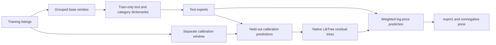

# Mercari optimization study

[中文](OPTIMIZATION.zh-CN.md) · [Competition journal](README.md) · [Frozen configuration](optimized-config.json)

The primary target is a **10% relative reduction in Kaggle private RMSLE** from
the scored baseline **0.43776**: the target is **0.393984 or lower**. Training
and inference costs are reported separately. This is a closed-competition
practice experiment; it does not establish an original-contest rank.

## Frozen local audit

The original **148,254-row holdout**, including 92 zero-priced listings, was
evaluated after freezing the configuration:

| Model / ablation | Holdout RMSLE ↓ |
| --- | ---: |
| Previously measured Ridge + LibTree baseline | 0.439312 |
| New Ridge | 0.433543 |
| Field-aware factorization | 0.418600 |
| Neural mixture | 0.397625 |
| Full blend without LibTree correction | 0.395064 |
| **Full blend with LibTree correction** | **0.394153** |

The relative holdout reduction is **10.28%**. Native correction contributes a
further 0.00091 RMSLE reduction with the same fitted experts. Actual Kaggle
verification is separate from this local result.

[Audit evidence](optimization-audit.json) · [Exploratory results](optimization-study.json)
· [Inference measurements](inference-optimization.json).

The separate [fast candidate](fast-config.json) was frozen from the existing
selection window after measuring cost, before either new Kaggle score was
available. It omits the global-Adam neural expert and the fitted Ridge reference.
Its selection RMSLE is **0.397274**, versus **0.395662** for the frozen accuracy
configuration. The Ridge reference alone improves selection RMSLE by about
0.00005. [Cost ablations](cost-ablation.json) retain every comparison. The fast
candidate has **no independent local holdout result**; its Kaggle score and
hosted runtime check are pending. The original accuracy configuration is retained.

Serving-cost comparison on the same first 100,000 unlabeled stage-two listings,
one warm-up and three interleaved repetitions:

| Pipeline | Mean, s | Min, s | Max, s | Population std, s |
| --- | ---: | ---: | ---: | ---: |
| Previous scored baseline | 7.941 | 7.067 | 9.231 | 0.931 |
| New audited ensemble | 34.819 | 31.699 | 40.973 | 4.351 |

The ensemble costs about **4.38×** as much inference time here. These are
complete pipeline timings, including feature preparation. The baseline model
was fitted on all labels; the new estimator is the local audit model. A tested
sparse-matmul projection preserved predictions (maximum log-price difference
4.10e-7) but averaged 34.558 s, within the observed variability; it was discarded.

An additional [batch-size study](sparse-batch-study.json) uses the same audited
weights, one warm-up per setting and four balanced, rotating repetitions:

| Sparse batch size | Mean, s | Min, s | Max, s | Population std, s |
| --- | ---: | ---: | ---: | ---: |
| 4,096 | 33.988 | 33.052 | 36.008 | 1.178 |
| 8,192 | 35.761 | 33.105 | 38.404 | 2.020 |
| **16,384** | **33.184** | **32.235** | **33.907** | **0.683** |
| 32,768 | 37.042 | 32.372 | 39.910 | 2.979 |

Here 16,384 reduces complete-pipeline mean time by **7.21%** against 8,192;
every measured prediction is bitwise identical. This optional serving setting
is separate from the submitted Kernels' original 8,192-row sparse batches.
A [joint-projection experiment](joint-projection-study.json) concatenated the
three first-layer kernels and split the result into the original heads. Its
means were 34.754/37.430 s for joint 8,192/16,384 versus eager 33.754 s; maximum
log-price difference was 4.10e-7. The joint implementation was discarded.

## Full local refit cost

The [final-only report](optimized-final-001.json) records **1,395,326 base-model
rows**, **87,209 disjoint calibration rows**, and **3,460,725 stage-two predictions**.
The process used a four-CPU quota and peaked at **10.15 GiB RSS** within a 32-GiB
memory limit. No GPU was used.

| Stage | Observed wall time, s |
| --- | ---: |
| Shared features and Ridge | 387.672 |
| Field-aware model, two sequential training epochs | 85.308 |
| Four neural models, including their feature preparation | 1,418.208 |
| Calibration features and expert predictions | 116.627 |
| Native LibTree calibration fit | 1.452 |
| Full stage-two prediction, features and CSV writing | 1,184.582 |
| **Whole process, including startup and other preparation** | **3,225.167 (53.75 min)** |

These are one full run's costs, with small concurrent tooling checks, rather
than repeated training measurements. The native fit uses 300 depth-three trees
on the calibration window. [Process resources](optimization-resources.json)
preserve the scope; repeated serving measurements appear above. CSV row count
and the first prediction's explanation sum were checked after completion.
These full-run costs are local. Hosted verification uses authenticated source
and artifact metadata plus actual competition scoring; hosted report downloads
are unavailable through this environment's egress proxy.

## Hosted runtime protocol

Version 3 returned `CANCEL_ACKNOWLEDGED` near its requested **3,600-second**
limit; the API supplied no failure reason and no competition submission was
attempted. Version 4 repeats the **identical uploaded script and configuration**
with a **7,200-second stage-two cap**. This larger cap is part of the experiment
record, alongside the baseline's 3,600-second cap.

The [official protocol snapshot](competition.json) specifies four cores, 16 GB
RAM, 60 minutes and 1 GB scratch/output, with a
[December 12 stage-two exception](https://www.kaggle.com/c/mercari-price-suggestion-challenge/discussion/45554):
longer stage-two runs are permitted when stage one finishes within 60 minutes.
A separate private stage-one Kernel is checking that runtime condition with the
same embedded model source and parameters. Its status remains **pending**;
the check concerns runtime, and the overall experiment remains post-contest
practice. [The journal](record.json) retains both attempts and their limits.

An independent [synthetic platform audit](runtime-audit.json) observed Python
3.13.15, Keras 3.13.2, TensorFlow 2.20.0, NumPy 2.1.3 and a four-CPU quota.
The sparse first-layer gradient remained `IndexedSlices`. Local dependency
versions are pinned separately. The hosted first neural epoch took about
519 s versus local 219 s; this is an observed environment difference, without
isolating its hardware or library cause. Hosted progress and printed reports
are available through the official `kaggle kernels logs --follow` API.

## What changed

The entry combines a field-aware factorization model, several complementary
neural text models, and a native C++ LibTree residual corrector. A sparse Ridge
model supplies another calibration feature. The improvement belongs to this
complete system; it does not isolate an improvement in the GBDT algorithm.

* Preserve single-character model and size tokens such as `6`, `7`, and `x`.
  Normalize `iphone6s` to `iphone 6s` while preserving units such as `64gb`.
  Stored preprocessing versions preserve older models' predictions.
* Recover missing brands only from unambiguous matches in a frozen training
  dictionary. Add category levels, category/condition and brand interactions,
  title character n-grams, and train-only smoothed word-price summaries.
* Solve sparse Ridge with matrix-free, diagonally preconditioned conjugate
  gradients. Implicit centering preserves the intercept and Ridge objective.
  Tests compare the coefficients and predictions with a dense Cholesky solver.
  The optional `ridge_reference: false` skips that solver when its outer blend
  weight is zero. A named mean prior keeps the calibration feature layout stable;
  explanations identify it as a prior. Existing configurations retain their
  fitted Ridge reference.
* Learn field-aware interactions across title, description, brand, category,
  and condition/shipping features. CPU workers own independent parameters and
  synchronize between chunks; they do not write shared parameters concurrently.
* Compare MSE, Huber regression, and price-bin classification. Sparse MLPs use
  bounded CSR batches. The row-sparse Adam variant aggregates duplicate gradient
  indices and updates only present rows; dense parameters retain standard Adam.
  This variant omits global matrix L2, which would make the gradient dense.
* Share listing preparation and the sparse feature matrix during inference.
  Fit LibTree on separate calibration listings rather than refitting large text
  models for every calibration fold. Stream stage-two ZIP inputs in Kaggle and
  omit large model pickles there; local runs can retain a reloadable model.
* Select the input stage explicitly for budget checks, with a separate Kernel
  identity and non-submission output for stage one. All embedded ZIP entries now
  have fixed timestamps, so repeated builds with identical inputs are stable.
  These builder changes concern input selection and packaging; each submitted
  model snapshot remains bound to its own source hash.

The accuracy audit and running version 4 use the archived `b7badbc` model
snapshot. The optional Ridge-skip path belongs to the later fast candidate;
source hashes bind each run to its own implementation.

## Evaluation protocol

All 1,482,535 official training rows are eligible, including the 874 zero-priced
listings. No external prices, test labels, scraping, or pretrained model inputs
are used. Identical available listing features share one group; ID and price
are excluded from that group key.

The original seed-42 split reserves approximately 80% for fitting, 10% for
tuning, and 10% for a final audit. Exploratory text hyperparameters and stopping
epochs use tuning data. The tuning window is also split by group into **74,129
calibration** and **74,126 selection** listings. Native correction fits the
former; blend weights, correction strength, and tree settings use the latter.
These exploratory tuning measurements are not an independent final test.

Freeze the configuration before the original holdout audit. Final training
then assigns about **16/17** of all labels to the base models and **1/17** to
LibTree calibration, with disjoint listing groups. All labels contribute to
the final system, in different roles. Final training uses fixed epochs and
weights; it performs no leaderboard-based model selection.



## Exploratory ablations

These rows use the same **148,255-row tuning window**, before the native
calibrator. Smaller RMSLE is better. They are local results, not Kaggle scores.

| Candidate | Tuning RMSLE | Observation |
| --- | ---: | --- |
| Expanded features, LSQR Ridge, alpha 3, 200 iterations | 0.449036 | Iteration cap was insufficient |
| Same features/alpha, preconditioned Ridge | 0.440556 | Better solution of the same objective |
| Preconditioned Ridge, alpha 10 | 0.437211 | Chosen regularization |
| Above, preserving model-number tokens | 0.435320 | Lexical resolution helps |
| Field-aware model, original tokens | 0.423157 | Early stopping matters |
| Field-aware model, repaired tokens | 0.420152 | Best at epoch 2 |
| Word-pooling network, MSE | 0.432245 | Useful ensemble diversity |
| Word-pooling network, Huber | 0.432122 | Little individual improvement |
| Binary sparse MLP, Adam + global L2, Huber | 0.417217 | Best at epoch 3 |
| Binary sparse MLP, row-sparse Adam, Huber | 0.416794 | Best at epoch 2 |
| Binary sparse MLP, row-sparse Adam, 64 price bins | 0.417463 | Complementary objective |
| Continuous sparse MLP, row-sparse Adam, Huber | 0.420258 | Marginal ensemble benefit; omitted |

The unrounded six-expert blend scored **0.396718** on the 74,126-row selection
window. A LibTree calibrator reduced that to **0.395657**. Adding four explicit
disagreement features changed the best result by only about 0.00008; that extra
feature variant is not enabled. The released configuration uses simple rounded
weights and is audited separately. CNN and repaired-token pooling candidates
were stopped after weak gains relative to their cost; they are not final models.

Huber and row-sparse optimization change both optimization behavior and
regularization. Their differences are not an isolated causal estimate of the
optimizer alone. Timings from concurrent exploratory runs are not used to claim
a controlled speedup. Repeated inference reports preserve arithmetic mean,
minimum, maximum, standard deviation, and every observation.

## Reproduce

Use Linux, Python 3.12, a C++17 compiler, and the official competition files. See the
[data download instructions](README.md#reproduce-locally). Large inputs,
predictions, caches, and models belong under ignored `benchmarks/runs/`.

```sh
python -m pip install '.[mercari]' kaggle
PYTHONPATH=. python -m benchmarks.mercari_advanced \
  --data-dir benchmarks/runs/mercari/data \
  --config benchmarks/mercari/optimized-config.json \
  --output-dir benchmarks/runs/mercari/optimized-final --mode final
```

The output directory must be empty. Outputs include the submission CSV, input
and source hashes, versions, timing report, model pickle, a readable tree,
JSON tree structure, and an explanation for the first actual test listing.
Use `--omit-model-artifact` to retain predictions and explanations without
saving the large pickle.

To repeat the serving comparison, retain trusted local model pickles from the
baseline and optimized study. Start a fresh process, without concurrent training:

```sh
PYTHONPATH=. python -m benchmarks.mercari_inference \
  --baseline-model benchmarks/runs/mercari/full-001/model.pkl \
  --optimized-model benchmarks/runs/mercari/optimized-audit/model.pkl \
  --test-file benchmarks/runs/mercari/data/test_stg2.tsv \
  --output benchmarks/runs/mercari/serving-comparison.json \
  --rows 100000 --repeats 3 --threads 4 --fm-threads 2
```

Adjust model paths to your actual output directories. The command checks each
model's predictions against its own warm-up, alternates model order, records
arithmetic mean/min/max/std and raw samples, and restores the Numba thread count.
Loading, input I/O and prediction checks are outside the timed region. Pickle
files must be trusted; they can execute code. This compares the supplied complete
systems, including any differences in their training sizes and capacity.

To compare sparse batches with identical weights, pass the same saved model
path to both model arguments and add `--sparse-batch-size 16384 --repeats 4`.
The override applies to the optimized copy. For an already loaded Mercari entry:

```python
from benchmarks.mercari_inference import configure_sparse_batches

configure_sparse_batches(entry, 16384)
prediction = entry.predict(listings)
```

This configures inference adapters in place using their existing trained
weights. The benchmark records the override and the number of sparse heads.

To reproduce the fixed local protocol, use `--mode study`. It reports selection
RMSLE without evaluating the holdout. Add `--audit-holdout` only after freezing
decisions. Retraining and the audit are substantial full-data computations.

Build and review the source-only private Kaggle script:

```sh
python -m benchmarks.mercari_kernel --owner YOUR_USERNAME \
  --stage two \
  --optimized-config benchmarks/mercari/optimized-config.json \
  --output-dir benchmarks/runs/mercari/optimized-kernel
kaggle kernels push -p benchmarks/runs/mercari/optimized-kernel -t 7200
kaggle kernels logs --follow YOUR_USERNAME/libtree-mercari-reproducible-entry
```

For the independent first-stage runtime check:

```sh
python -m benchmarks.mercari_kernel --owner YOUR_USERNAME --stage one \
  --optimized-config benchmarks/mercari/optimized-config.json \
  --output-dir benchmarks/runs/mercari/stage-one-kernel
kaggle kernels push -p benchmarks/runs/mercari/stage-one-kernel -t 3600
kaggle kernels status YOUR_USERNAME/libtree-mercari-stage-one-budget
```

Stage one uses a separate Kernel ID, writes `stage-one-predictions.csv` and a
`STAGE_ONE_BUDGET_CHECK_NEVER_SUBMIT.txt` marker. Its predictions are for the
runtime check. Model and credential files are excluded from the source bundle.
For parallel variants, use `--kernel-name` with a distinct lowercase slug, such
as `libtree-mercari-fast-entry` or `libtree-mercari-fast-stage-one-budget`, and
replace the configuration path with `benchmarks/mercari/fast-config.json`.

Record the version returned by the push. After the full Kernel completes,
submit the stage-two `submission.csv` using that exact version, as described in the
[journal](README.md). The builder does not submit automatically.

## Understanding the prediction

RMSLE compares `log1p(price)`, so learning that quantity aligns regression with
the official metric. Ridge learns additive word effects. Factorization models
learn effects such as **a word combined with a brand** using small vectors.
Sparse MLPs learn nonlinear combinations of word and category features. Huber
reduces the influence of large errors; price-bin classification predicts a
distribution and converts it to an expected log price.

The weighted experts produce a base log price. LibTree predicts a correction
from metadata and held-out expert predictions. A correction of `0.1` multiplies
`price + 1` by approximately `1.105`. Exported paths explain this residual
component; the full explanation also reports weighted expert contributions.
Those contributions sum on the **log-price scale**, not in dollars, and are
not causal effects or SHAP values.

For tree fundamentals, see the offline [interactive learning guide](../../docs/LEARNING_GUIDE.html)
and [native prediction-path guide](../../docs/explain.md).

## Tests and references

[Verification evidence](optimization-verification.json) records **52 passing
Mercari tests and 1,060/1,060 covered Python statements**, plus four separate
compiled-FM tests. The combined local and CI suite includes stage-specific budget checks and
serving CLI tests, plus a separate replay using both real saved models.
The core retains **505/505 Python statements and 2,790/2,790
C++ lines covered**. [GitHub Actions run 39045263809](https://github.com/wxwidget/libtree/actions/runs/39045263809)
passed all jobs, including sanitizer, thread sanitizer and the new installed-wheel
Mercari integration job. The installed-wheel check prevents an unbuilt source
package from shadowing its compiled native library in CI. The
[workflow](../../.github/workflows/test.yml) contains the exact dependency,
coverage and compiled-kernel verification commands.

Tests cover train-only preprocessing, legacy refits, scalar/model tokens,
group separation, dense/sparse numerical equivalence, exact factorization
arithmetic, worker synchronization, sparse optimizer updates, stable soft
labels, serialization, contribution sums, final-only execution and ZIP input
handling. Line coverage for Numba functions uses executable Python kernels
with `NUMBA_DISABLE_JIT=1`; compiled parallel kernels are tested separately.
This is statement coverage, not a claim of 100% branch coverage. The C++ core
retains its separate sanitizer, coverage, worker-lifecycle and memory checks.

1. [Jankiewicz & Lopuhin, first-place Mercari technical presentation](https://github.com/pjankiewicz/mercari-solution/blob/374301ad1c32cbc93dcc40313d5d7bb9c5503746/presentation/5_modeling.tex): sparse MLPs, robust/bin losses, increasing batches and ensemble diversity. Independent Keras 3 implementation here; the authors' reported scores are not our measurements.
2. [Chenglong Chen, fourth-place Mercari report](https://github.com/ChenglongChen/tensorflow-XNN/tree/6534a832f5b4461cbdf1ebbdf5620a0cd80f0aa9): multi-field models and sparse optimization.
3. [Hestenes & Stiefel (1952), conjugate gradients](https://doi.org/10.6028/jres.049.044).
4. [Micci-Barreca (2001), smoothed categorical encoding](https://doi.org/10.1145/507533.507538).
5. [Rendle (2010), factorization machines](https://doi.org/10.1109/ICDM.2010.127); [Juan et al. (2016), field-aware factorization](https://doi.org/10.1145/2959100.2959134).
6. [Stich (2019), local SGD](https://openreview.net/forum?id=S1g2JnRcFX).
7. [Huber (1964), robust estimation](https://doi.org/10.1214/aoms/1177703732); [Kingma & Ba (2015), Adam](https://arxiv.org/abs/1412.6980).
