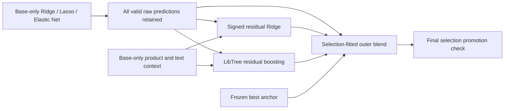

# Retain weak experts for residual fusion

[中文](RESIDUAL_FUSION.zh-CN.md) · [Machine-readable results](residual-fusion-results.json) · [Sparse experts](SPARSE_PENALTIES.md)

## What the ensemble actually does

The current Mercari ensemble has several layers. It performs regression on
`z = log1p(price)`, rather than majority voting:

1. Base experts learn different text representations and objectives.
2. Calibration branches learn errors of base-only predictions. A branch can be
   `q(x) = b(x) + h(raw_predictions(x), context(x))`.
3. The outer model combines the frozen anchor, raw experts and correction
   branches. It selects nonnegative simplex, affine or category-dependent
   weights using selection data. Prices are `expm1(max(z, 0))`.

The frozen 0.380616 anchor uses a nonnegative sum-one outer blend, with residual
tree models inside several branches. The sparse-expert experiment additionally
supports a bounded intercept and regularized category weights. The signed
coefficients introduced here belong to the **inner residual linear model**;
they do not remove the outer nonnegative-weight constraint.

The frozen anchor's five active outer weights are 38.4579% historical full
ensemble, 4.8394% CPU multiscale, 26.5906% product-calibrated LibTree depth 5,
20.0964% product-calibrated LightGBM and 10.0157% product-calibrated XGBoost.
Each weight multiplies a **log-price prediction**, not a class vote or raw price.



## Why weak models can help

For squared log error, the negative gradient with respect to the current
prediction is `r = z - prediction`. Gradient boosting learns a function aligned
with that residual and takes a shrunk step. A model can have poor standalone
RMSLE but contain information about the residual, or be useful in a particular
product region. Standalone ranking therefore cannot decide ensemble utility.

Independently trained weak models do not acquire a boosting guarantee simply
by being averaged. Correlated errors, irrelevant predictions and overfitting
can still hurt. This implementation measures conditional contribution rather
than treating every weak candidate as a required nonzero final weight.

The previous sparse experiment already retained all six experts, including
nonconverged Lasso/Elastic Net. Its final linear blend assigned them zero weight;
it did not discard them before fitting. This change expands what the later
fusion can learn from them.

## Automatic behavior and boundaries

- All finite, ID-aligned raw experts survive, regardless of standalone score,
  convergence warnings or zero direct blend weight. Invalid data remain errors.
- The inner reference is the raw expert with minimum calibration squared error.
  A standardized, signed Ridge correction uses fixed alpha 100. A separate
  LibTree GBDT uses 300 trees, depth 4, learning rate .04, 128 bins, minimum leaf
  100 and L2 20. Neither correction branch has an early quality gate.
- Inputs include the raw reference, every raw expert's deviation from it,
  base-only product statistics and label-free text attributes. Every candidate
  can contribute indirectly even if its direct outer weight is zero.
- Both corrections fit calibration labels only. They are parallel candidates;
  the tree is **not** trained on in-sample residuals of the fitted Ridge layer.
  Its internal trees perform sequential gradient boosting.
- The corrected best anchor never enters calibration features or residual
  targets: it already used those labels. It enters only the outer blend.
- Family ablations refit both correction models without the excluded family.
  This removes indirect use as well as the raw prediction column. The raw-only
  pool isolates the effect of adding residual branches.
- The final half-selection check still requires improvement of at least 1e-5
  RMSLE over the anchor. A failure preserves its predictions exactly. This final
  promotion rule is separate from candidate retention.

Parameters are fixed internal defaults; no new model tuning is required.

## Reproduce

Use the prepared, grouped 80/5/5/10 base/calibration/selection/audit split and the
six trusted base-only artifacts from [the sparse study](SPARSE_PENALTIES.md).
With the Mercari dependencies installed:

```bash
OMP_NUM_THREADS=4 OPENBLAS_NUM_THREADS=4 python -m benchmarks.mercari_residual \
  --data-dir benchmarks/runs/mercari/frontier-001/data \
  --anchor benchmarks/runs/mercari/smalltext-t4-001/primary-blend/ensemble.npz \
  --experts-dir benchmarks/runs/mercari/sparse-penalties-001/implicit \
  --output-dir benchmarks/runs/mercari/residual-retention-reproduction
```

The output directory must be new. Input data hashes must match the source
study; all three windows require exact ordered IDs and finite prediction vectors.
The command records input/source hashes, keeps all eight correction checkpoints,
context statistics and predictions, freezes selection weights and promotion
before opening audit labels, and writes `plan.json`, `frozen.json`, `report.json`,
`blenders.pkl` and `ensemble.npz`. Cached base fitting/inference cost is excluded.

Fresh `python -m benchmarks.mercari_top3 ...` runs automatically execute the same
residual stage after fitting the six experts. Reproduction starts with local
data/artifacts; large datasets, checkpoints and credentials are ignored by Git.
Follow the linked sparse and small-text studies to reconstruct prerequisites.

## Evidence and limitations

<!-- measured-results -->
On 1,186,026 base rows, 74,129 calibration rows, 74,126 selection rows and
148,254 reused audit rows, all six raw experts were retained. Four family pools
produced eight correction branches. No GPU was used.

| Branch (before outer blending) | Selection RMSLE | Audit RMSLE | Fit seconds | Mean inference seconds |
| --- | ---: | ---: | ---: | ---: |
| Ridge-only residual linear | 0.465227 | 0.464528 | 0.069 | 0.093 |
| All six residual linear | 0.460175 | 0.459186 | 0.089 | 0.105 |
| Without Lasso residual linear | 0.460860 | 0.459925 | 0.077 | 0.145 |
| Without Elastic Net residual linear | 0.462589 | 0.461765 | 0.101 | 0.126 |
| Ridge-only residual boosting | 0.451912 | 0.451688 | 1.201 | 0.604 |
| Without Lasso residual boosting | 0.449617 | 0.449081 | 1.292 | 0.345 |
| Without Elastic Net residual boosting | 0.450448 | 0.449999 | 1.632 | 0.573 |
| All six residual boosting | 0.449626 | 0.449182 | 1.350 | 0.338 |

The raw pair-view Ridge reference has audit RMSLE **0.472611**. The all-six
residual tree reaches **0.449182**, versus **0.451688** with four Ridge experts
only: a **0.555%** relative reduction within this sparse-only branch. Removing Lasso
slightly helps that tree; removing Elastic Net hurts it. Neither is required to
improve every combination.

The full tree makes **76** splits on the Lasso deviation and
**218** on the Elastic Net deviation, out of
**3864** internal splits. The signed residual linear model uses
unscaled deviation coefficients **0.601941** and
**-1.208014**, respectively. These show actual use,
not causal feature importance; correlated predictors can have unstable coefficients.

**Final result: no promotion.** Raw-only and residual-augmented outer blends both
choose the anchor with effectively zero weight on the new branches. A fitted
anchor-only bias gives audit **0.380616369**, slightly worse than the original
**0.380616255**. The final selection check rejects that proposal and preserves
all three original prediction arrays **exactly** (maximum difference 0).
No new Kaggle submission was made. The whole-study timer reports
**78.05 seconds**, with **2592.4 MiB** peak process RSS. It includes data/hash checks,
context construction, eight models, repeated inference and outer fitting, but
stops before final bootstrap/output writes; it excludes cached base work.
The feature-use counts and coefficients are post-freeze diagnostics.

The full CPU optimization regression passes **175 tests** in **212.50 seconds**,
with **3,126/3,126 statements across 24 modules covered (100%)**. The new residual
module covers all 125 statements. This is statement coverage for this suite,
not repository-wide, branch or GPU coverage. TDD records the initial missing-module
failure, then passing signed-complementarity, conditional-tree learning, exact
pickle replay, family exclusion, anchor isolation, finite/ID/hash guards,
pre-audit freeze and exact fallback tests. The suite reports 492 existing warnings.

The JIT-enabled targeted regression also passes **17 tests in 4.49 seconds**.
<!-- /measured-results -->

The selection and confirmation windows were inspected in earlier experiments.
The results are a conditional local audit, not an untouched test or a Kaggle
leaderboard score. Selection compares methods on a grouped half-window and then
refits weights on the full selection window. That check is reused for method
choice and promotion; it is not an independent test of the chosen method.
Performance is one CPU study; inference times are arithmetic means of three
prepared-feature passes over all three prediction windows. They exclude text
preprocessing, product feature construction and cached base prediction cost.

## References

- Friedman (2001), *Greedy Function Approximation: A Gradient Boosting Machine*,
  [doi:10.1214/aos/1013203451](https://doi.org/10.1214/aos/1013203451).
- Wolpert (1992), *Stacked Generalization*,
  [doi:10.1016/S0893-6080(05)80023-1](https://doi.org/10.1016/S0893-6080(05)80023-1).
- Micci-Barreca (2001), *A Preprocessing Scheme for High-Cardinality Categorical
  Attributes in Classification and Prediction Problems*,
  [doi:10.1145/507533.507538](https://doi.org/10.1145/507533.507538).

These motivate residual fitting, held-out meta-training and smoothed product
statistics. The fixed defaults and experiment protocol are our adaptation.
