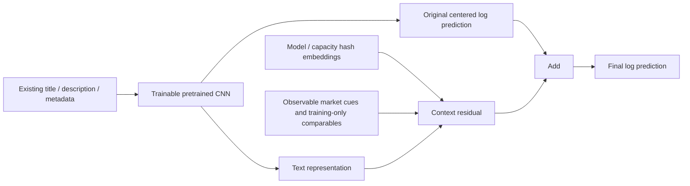

# Comparable retrieval and joint text-body fine tuning

[中文](RETRIEVAL_TRUNK.zh-CN.md) · [Results](retrieval-trunk-results.json) · [Previous pre-fusion heads](MARKET_MODELS.md)

## Question and target

The prior head-only study improved one text branch but did not improve the
$100–<$500 region substantially. This follow-up changes the trainable text
model itself and supplies better comparable-item information. The final
72-expert fusion and its weights remain unchanged.

The scored target stays `log1p(price)` squared error, with nonnegative clipping
at prediction. Its population optimum is `E[log1p(price)|X]`; exponentiating that
is generally below `E[price|X]` by Jensen's inequality. No Gaussian price model is
required. An arithmetic-dollar bias correction or indiscriminate upward scaling
changes the target. Better product information can instead narrow the conditional
price distribution. True-price-bucket underprediction alone does not prove that
a deployable, feature-conditioned calibration correction exists.

## Reference and equal-budget comparisons

The fixed starting point is the existing `cnn128_mse.keras`, with its original
base-fitted listing normalization, vocabulary and numeric/categorical inputs.
The original weights were trained on the 1,186,026-row base window and their
historical checkpoint was chosen using selection. This history is not undone.
Current calibration and audit windows have also been inspected previously.

All fine-tuned variants start at exactly the same CNN forecast. They share:

- The entire original **trainable** text body and original output path.
- A 16-token, 8192-bucket stable hash channel for raw alphanumeric model/GB/TB/unit
  strings, with trainable 16-dimensional embeddings and masked pooling.
- A 64-unit context residual, initialized with a zero final layer. It receives the
  text body's latent representation and the new identity/context inputs.
- An identical parameter count, dropout, optimizer, training rows and schedules.
  Control inputs mask the new channels to zero; market inputs enable identity and
  20 lexical cues; retrieval inputs additionally enable eight comparable features.



This is joint supervised fine tuning, not a frozen text body followed by an
external calibrator. Both the number of body tensors changed during training
and the number changed in the **selected checkpoint** are recorded. A restored
epoch-zero fallback must not be presented as a successfully fine-tuned checkpoint.

For a beginner, consider a title such as `iPhone 6 64GB unlocked` with a
description saying `no cracks`. The original network still reads its text and
metadata. The new identity channel retains model/capacity strings, while the
market channel distinguishes negated damage from an actual failure phrase.
The retrieval channel summarizes other training listings in the same category,
with brand/condition controls. These signals can help distinguish a device from
an accessory or another generation; they cannot verify a seller's claim.
The network predicts the **whole listing's** log price, including bundles.
Nothing divides the target by an estimated quantity or supplies the query price.

## Comparable lookup and label exclusion

`ComparableRetrieval` uses title unigram/bigram TF-IDF cosine, exact category
blocking and a known-brand filter. Condition-code distance receives a fixed
soft penalty. Unknown categories back off to a global prior; an explicit unseen
brand does not silently match another brand. Missing brands may use the category
pool. This is **bounded lexical retrieval**, not semantic vector ANN search or
an exhaustive nearest-neighbor query.

Reference rows sharing all available listing features are one group. Their log
prices are aggregated; per-group second moments retain within-group dispersion.
The query excludes its complete matching group, including records with different
IDs or prices. Category and global target priors also subtract that group's full
label sum and count. There is no leave-one-row-out shortcut that retains a
price-changing duplicate.

The index is ordered by feature hashes, not target values. Two rare category/token
postings generate candidates, scanning at most 128 entries per posting and scoring
at most 64 distinct reference groups. The eight strongest candidates above 0.35
similarity contribute cosine-to-the-fourth weighted moments. Local means shrink
with `n/(n+5)` toward a category prior, itself smoothed with strength 20. These are
fixed heuristic support controls, not a fitted Bayesian posterior.

The resulting eight inputs are category prior, local mean/std, log neighbor
support, maximum/mean similarity, shrunken mean, and mean-minus-prior. Market cues
come from the existing negation/quantity/role extractor; they remain approximate
linguistic signals, not verified product condition or authenticity.

Tests change every label in a query's duplicate group and verify its raw retrieval
features stay fixed. They also check no cross-category matches, unknown brands,
no-neighbor priors, query-batch independence, input reordering and serialization.
Base-derived normalization is shared across views; held-out query prices are
never fitted. The fitted CNN itself naturally remains a supervised model.

## Predeclared evaluation and safeguards

- Base: **1,186,026** rows. Calibration: **74,129**. Selection: **74,126**.
  Reused audit: **148,254**. The original grouped windows are unchanged.
- Full-base fine tuning uses **two epochs**, batch **4096**, Adam rates **1e-4,
  5e-5**, gradient clipping 1 and the existing dropout. No price weighting,
  high-price oversampling or zero-price deletion is performed.
- Primary seed 42 tests control, market and retrieval views. Seed 43 repeats
  control and retrieval for stability, using the same pretrained initial weights.
  These are two shuffle/dropout repetitions, not two from-scratch initializations.
- Calibration picks checkpoints, including epoch zero. A promoted checkpoint
  must reduce overall RMSLE by more than 1e-5 and keep RMSLE below **1.005 times**
  its reference in each sufficiently supported true-price slice: **<$10** and
  **$100–<$500**, each needing at least **200 rows**.
- Control compares with the original CNN; market/retrieval compare with their
  matched-seed selected control. The same requirements apply on selection before
  primary-seed candidates can replace the original branch. Selection chooses
  among original/control/market/retrieval, with 1e-5 ties preferring earlier/simple
  candidates. Seed 43 and unconstrained diagnostic checkpoints cannot win this check.
- All models, outputs and choices freeze before audit labels are loaded. The
  `diagnostic` checkpoint also retains the best calibration RMSLE regardless of
  the slice guardrails; failed candidates are preserved for later investigations.
  They are not silently promoted or discarded on their standalone score.

True prices are used for training targets and validation diagnostics, never as
routing inputs at inference. The >=$500 tail is too small to tune repeatedly.
Historical window reuse and prior reference selection limit generalization.
Bootstrap intervals condition on fitted models, omit training/selection
uncertainty and use rows rather than duplicate groups.

## Measured results

The frozen branch choice is **`retrieval_seed42`**, from one available CNN
checkpoint. The previous head study used a stronger sparse branch; the complete
ensemble's selected audit RMSLE remains **0.379348**.

| Checkpoint | Calibration RMSLE | Selection RMSLE | Reused audit RMSLE | Selected epoch | Body tensors changed |
| --- | ---: | ---: | ---: | ---: | ---: |
| original | 0.426898 | 0.427283 | 0.424760 | — | 0 |
| control_seed42 | 0.426523 | 0.427260 | 0.424193 | 1 | 17 |
| market_seed42 | 0.426898 | 0.427283 | 0.424760 | 0 | 0 |
| retrieval_seed42 | 0.425646 | 0.426418 | 0.423351 | 1 | 17 |
| control_seed43 | 0.426898 | 0.427283 | 0.424760 | 0 | 0 |
| retrieval_seed43 | 0.426898 | 0.427283 | 0.424760 | 0 | 0 |

Unconstrained diagnostic checkpoints are retained separately; audit scores never
decide their checkpoints or promote them:

| Diagnostic | Calibration RMSLE | Selection RMSLE | Reused audit RMSLE | Body tensors changed |
| --- | ---: | ---: | ---: | ---: |
| diagnostic_control_seed42 | 0.426523 | 0.427260 | 0.424193 | 17 |
| diagnostic_market_seed42 | 0.426581 | 0.427340 | 0.424261 | 17 |
| diagnostic_retrieval_seed42 | 0.425646 | 0.426418 | 0.423351 | 17 |
| diagnostic_control_seed43 | 0.426347 | 0.427042 | 0.423965 | 17 |
| diagnostic_retrieval_seed43 | 0.425312 | 0.426044 | 0.422973 | 17 |

Paired reused-audit RMSLE differences (negative is better), with 300 row-bootstrap
repetitions. Diagnostic comparisons use matched **diagnostic** controls; guarded
comparisons use guarded controls. These intervals condition on fitted models:

| Comparison | RMSLE difference | Conditional 95% interval |
| --- | ---: | --- |
| retrieval_seed42 vs control_seed42 | -0.000842341 | [-0.000904273, -0.000787206] |
| diagnostic_retrieval_seed42 vs diagnostic_control_seed42 | -0.000842341 | [-0.000904273, -0.000787206] |
| retrieval_seed43 vs control_seed43 | 0.000000000 | [0.000000000, 0.000000000] |
| diagnostic_retrieval_seed43 vs diagnostic_control_seed43 | -0.000991572 | [-0.001048787, -0.000930071] |
| diagnostic_retrieval_seed42 vs diagnostic_market_seed42 | -0.000910323 | [-0.000965383, -0.000860082] |

| True price, dollars | Rows | Original CNN | Control 42 | Market 42 | Retrieval 42 |
| --- | ---: | ---: | ---: | ---: | ---: |
| 0–<5 | 3,622 | 0.753644 | 0.736701 | 0.753644 | 0.734176 |
| 5–<10 | 24,081 | 0.428992 | 0.422092 | 0.428992 | 0.420779 |
| 10–<20 | 55,585 | 0.328978 | 0.331904 | 0.328978 | 0.331861 |
| 20–<50 | 48,946 | 0.397340 | 0.398948 | 0.397340 | 0.398574 |
| 50–<100 | 11,565 | 0.553542 | 0.553999 | 0.553542 | 0.552290 |
| 100–<200 | 3,353 | 0.743917 | 0.742808 | 0.743917 | 0.739409 |
| 200–<500 | 993 | 0.958891 | 0.954329 | 0.958891 | 0.949872 |
| 500–<1000 | 94 | 1.258468 | 1.259045 | 1.258468 | 1.251910 |
| 1000–<∞ | 15 | 1.909617 | 1.902547 | 1.909617 | 1.890756 |

The two primary safeguards and high-price dollar diagnostics are:

| Selected checkpoint | <$10 RMSLE | $100–<$500 RMSLE | High-price dollar bias | High-price underprediction |
| --- | ---: | ---: | ---: | ---: |
| original | 0.483976 | 0.798155 | -51.28 | 81.57% |
| control_seed42 | 0.475212 | 0.796107 | -51.26 | 82.24% |
| market_seed42 | 0.483976 | 0.798155 | -51.28 | 81.57% |
| retrieval_seed42 | 0.473687 | 0.792439 | -50.41 | 81.73% |

All supplementary selected/diagnostic prediction hashes are retained in
[retrieval-candidates.json](retrieval-candidates.json), without a standalone-score
filter. This file is compatible with the existing candidate loader; it is not
an update to the frozen final-fusion manifest. A future ensemble study still
needs its own disjoint meta roles and frozen promotion decision.

### Interpretation and failures

The primary selected CNN branch improves from **0.424760 to 0.423351** audit
RMSLE (**0.332%**). Continuing training alone reaches 0.424193; retrieval adds
**0.199%** beyond that matched control. The trained market-only diagnostic is
0.424261, slightly worse than control. More product cues alone are not sufficient;
the eight comparable features improve on that trained market view as well.

For the primary seed, the $100–<$500 slice improves from **0.798155 to 0.792439**,
or **0.461%** relative to the trained control's 0.796107. The <$10 slice also
improves. These are aggregate log-error changes, not the fraction of perfectly
priced items. High-price dollar bias remains negative, and **all 15 listings
priced at least $1000 remain underpredicted**. The expensive tail is not solved.

Seed 43's unconstrained retrieval diagnostic improves overall audit RMSLE from
its trained control's **0.423965 to 0.422973**. However, both views fail the
predeclared high-price calibration safeguard and their protected checkpoints
restore epoch zero. Thus there is repeated overall-score evidence for retrieval,
but **not a seed-stable high-price promotion**. The primary seed was fixed before
training; the better seed-43 audit score cannot replace it after the fact.

For deployment, warm raw-input inference increases from **0.1845 to 0.3572
seconds per 2,048 listings**, about **1.94 times** the control cost, and adds a
201-MiB lookup index. Cached neural timings hide that feature overhead. This is
an accuracy gain requiring additional serving latency and memory.
Before a full-system promotion, test a retrieval-only cue ablation, reduce feature
construction cost while preserving outputs, and assess checkpoint averaging or
stronger trunk regularization on unused validation roles. None is a measured
result of this study. Future fusion must establish complementary gain itself.

## Runtime, artifacts and scope

The lookup/encoding cache is shared across every run. It records source, library,
model, data and per-array hashes and ordered IDs. The preparation command never
loads audit labels. Training uses the full base and calibration for checkpoints;
there is no fitting on selection or audit rows.

All durations are wall-clock seconds. Equal schedules control model/training
budgets; they do not assert equal measured runtimes or a production speedup.
There is one fine-tuning fit per view/seed. Sequential fit durations include
graph tracing, calibration/checkpoint work and shared-machine variation; they
are observed costs, not repeated evidence of a training speed advantage.

The current machine has a four-vCPU quota and no GPU. Preparation uses two Numba
threads; fine tuning uses four TensorFlow intra-op threads and one inter-op
thread. Existing CNN pretraining and original tokenizer fitting are reused and
excluded from this round's incremental cost. Model imports are outside the
training timer. Each selected model reports three repeated inference timings on
**74,129 calibration rows**, with arithmetic mean, maximum, standard deviation
and raw samples; these use cached inputs and exclude feature construction.

Shared input preparation took **253.36 seconds**;
the neural experiment took **2079.86 seconds**, with peak process
RSS **3546.1 MiB**. The retrieval index is
**201.3 MiB**. Added parameters are
**143,249**
above the original **12,838,897**.

| Model | Fine tuning/checkpointing seconds | Cached inference mean seconds | Maximum | Std. dev. |
| --- | ---: | ---: | ---: | ---: |
| control_seed42 | 441.10 | 1.701 | 1.870 | 0.120 |
| market_seed42 | 387.15 | 2.019 | 2.581 | 0.407 |
| retrieval_seed42 | 349.81 | 1.671 | 1.754 | 0.094 |
| control_seed43 | 387.31 | 1.785 | 1.954 | 0.131 |
| retrieval_seed43 | 329.62 | 2.145 | 2.435 | 0.325 |

An additional three-repeat warm measurement reconstructs **2,048 target-free
raw listings** already parsed in memory and runs the saved model. It excludes
CSV I/O, model/index loading, initial TensorFlow tracing and Numba compilation; it includes
lexical/token features and applicable lookup:

| View | Raw-input inference mean seconds | Maximum | Std. dev. |
| --- | ---: | ---: | ---: |
| control | 0.1845 | 0.1875 | 0.0021 |
| market | 0.3008 | 0.3024 | 0.0014 |
| retrieval | 0.3572 | 0.3586 | 0.0011 |

These different batch sizes and feature scopes must not be compared as the same
throughput measurement. Complete raw timing samples and artifact hashes are in
the machine-readable results.

Selected and diagnostic Keras files contain the complete learned network without
optimizer states. Deployment also needs the original `tokens.pkl`, retrieval
index, context normalization and feature code. The full training input arrays
and audit labels are not inference requirements. All large data/model/cache
files stay ignored by Git.

Import `benchmarks.mercari_neural` before `tf.keras.models.load_model(...)` to
register the serialized `MaskedPool` layer. Run from the repository root so the
canonical benchmark modules used by the trusted tokenizer/index are importable.

## Reproduce

First prepare the original CNN and tokenizer through the [frontier workflow](FRONTIER.md).
Use the repository's `.[mercari,benchmark]` environment. The default schedules,
seeds, lookup bounds and safeguards are built in; only paths are configured.
The warm-start folder must contain `tokens.pkl` and `cnn128_mse.keras`; a
prediction archive alone cannot fine-tune the network. Colab downloads need
`--include-models`. The committed default manifest identifies this historical
run's exact prediction bytes, not arbitrary newly trained weights.

```bash
OMP_NUM_THREADS=2 OPENBLAS_NUM_THREADS=2 NUMBA_NUM_THREADS=2 \
TF_NUM_INTRAOP_THREADS=2 TF_NUM_INTEROP_THREADS=1 \
python -m benchmarks.mercari_retrieval_trunk --prepare \
  --data-dir benchmarks/runs/mercari/frontier-001/data \
  --model-dir benchmarks/runs/mercari/frontier-001/gpu-models \
  --cache-dir benchmarks/runs/mercari/retrieval-reproduction/inputs

OMP_NUM_THREADS=4 OPENBLAS_NUM_THREADS=2 NUMBA_NUM_THREADS=2 \
TF_NUM_INTRAOP_THREADS=4 TF_NUM_INTEROP_THREADS=1 \
python -m benchmarks.mercari_retrieval_trunk \
  --data-dir benchmarks/runs/mercari/frontier-001/data \
  --model-dir benchmarks/runs/mercari/frontier-001/gpu-models \
  --cache-dir benchmarks/runs/mercari/retrieval-reproduction/inputs \
  --output-dir benchmarks/runs/mercari/retrieval-reproduction/full
```

For a **newly trained reference**, retain its `cnn128_mse.npz` and create a local
manifest from the actual base-only worker outputs. Adapt these paths and pass
`--manifest .../reference.json` to the preparation command (and use the matching
`--data-dir` / `--model-dir` for both commands):

```python
import json
from pathlib import Path
from benchmarks.mercari import sha256

data = Path("benchmarks/runs/mercari/frontier-local/data")
worker = Path("benchmarks/runs/mercari/frontier-local/gpu-models")
prediction = worker / "cnn128_mse.npz"
destination = Path("benchmarks/runs/mercari/retrieval-reproduction/reference.json")
destination.parent.mkdir(parents=True, exist_ok=True)
destination.write_text(json.dumps({
    "data_sha256": {w: sha256(data / (w + ".tsv.gz"))
                    for w in ("train", "calibration", "selection", "confirmation")},
    "experts": [{"name": "frontier_cnn128_mse", "path": str(prediction),
                 "sha256": sha256(prediction), "fit_window": "base", "family": "frontier"}],
}, indent=2) + "\n")
```

The frontier's `gpu --neural-only sequence --max-features 150000` worker saves
these artifacts; `--allow-cpu` permits CPU execution without implying GPU use.
New pretraining can change the numerical baseline and results. Keep its own
manifest rather than overwriting the historical reference or disabling checks.

Both destination directories must be new. A complete existing input cache may be
reused only with matching identities and file hashes. `plan.json` precedes neural
training, `frozen.json` precedes audit access, and `report.json` adds audit metrics,
price buckets, checkpoints, changed-body counts, paired comparisons and costs.
The historical final-fusion manifest remains unchanged.

After training finishes, the official dollar-space metric can be checked without
the experiment's scoring function:

```python
from pathlib import Path
import numpy as np
from sklearn.metrics import mean_squared_log_error

out = Path("benchmarks/runs/mercari/retrieval-reproduction/full")
assert (out / "report.json").is_file()
with np.load("benchmarks/runs/mercari/frontier-001/data/evaluation.npz") as labels:
    actual = np.expm1(labels["confirmation"].astype(np.float64))
    for file in sorted(out.glob("*.npz")):
        with np.load(file) as predictions:
            assert np.array_equal(predictions["confirmation_ids"], labels["confirmation_ids"])
            price = np.expm1(np.maximum(predictions["confirmation"].astype(np.float64), 0))
            print(file.stem, np.sqrt(mean_squared_log_error(actual, price)))
```

```bash
NUMBA_DISABLE_JIT=1 python -m pytest tests/test_mercari_retrieval.py \
  tests/test_mercari_retrieval_inputs.py tests/test_mercari_retrieval_trunk.py \
  --cov=benchmarks.mercari_retrieval --cov=benchmarks.mercari_retrieval_inputs \
  --cov=benchmarks.mercari_retrieval_trunk --cov-report=term-missing --cov-fail-under=100
python -m pytest tests/test_mercari_retrieval.py -q
```

The first command measures executable Python reference statements; the second
exercises the actual compiled parallel lookup. Passing one is not a substitute
for the other.

CI-matched CPU regression: **230 tests passed**,
**31 benchmark modules**, **4,245/4,245 executable statements (100%)**.
The three new modules also each reach 100%; six actual compiled-retrieval tests
pass separately. This is statement coverage of the specified CPU benchmark
modules, not whole-repository, branch, GPU or leak coverage.

Independent dollar-space RMSLE recomputation checked **11 outputs and 99 price
buckets**, with maximum overall-score difference **5.55e-17**.
All ten saved neural checkpoints replay from **2,048 raw target-free listings**,
and their actual original-body tensor changes match the recorded metadata.
Source/data/cache hashes, ordered IDs and the pre-audit frozen file also match.

## Research sources

- Salton & Buckley (1988), [TF-IDF weighting](https://doi.org/10.1016/0306-4573(88)90021-0).
- Micci-Barreca (2001), [target smoothing](https://doi.org/10.1145/507533.507538).
- Iyyer et al. (2015), [deep averaging](https://aclanthology.org/P15-1162/).
- Kim (2014), [CNN text representations](https://aclanthology.org/D14-1181/).
- Gneiting (2011), [point targets and scoring rules](https://doi.org/10.1198/jasa.2011.r10138).
- Izmailov et al. (2018), [stochastic weight averaging](https://arxiv.org/abs/1803.05407),
  a possible follow-up, not implemented or evaluated here.
- Jankiewicz & Lopuhin, [Mercari modeling source](https://github.com/pjankiewicz/mercari-solution/blob/master/presentation/5_modeling.tex).

The blocked lookup, duplicate-group exclusion and zero-initialized joint context
branch are independent task adaptations, not reproduced paper/leaderboard results.
No new Kaggle score or rank follows from these local experiments.
