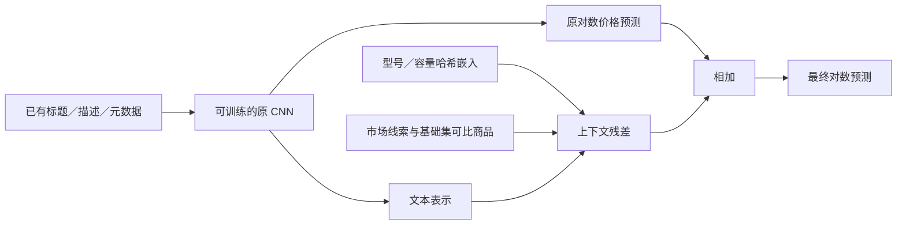

# 同款检索与文本主干联合微调

[English](RETRIEVAL_TRUNK.md) · [完整结果](retrieval-trunk-results.json) · [上一轮融合前预测头](MARKET_MODELS.zh-CN.md)

## 目标和本轮修改范围

上一轮只优化预测头，100–<500 美元基本未改善。本轮将可比商品信息加入神经网络，
并真正更新原有文本主干。最终 72 个专家的融合模型和权重保持不变。

继续使用 `log1p(price)` 的平方误差，预测时截断为非负对数值。其总体最优点为
`E[log1p(price)|X]`，还原后通常低于美元算术均值，这是 Jensen 不等式的结果，
不要求价格服从高斯分布。增加美元均值补偿或整体涨价会改变目标；本轮希望用品质
更好的商品信息缩小条件价格分布。按真实价格分桶后高价被低估，本身不能证明存在
可直接部署的校准修正。

## 固定起点和同预算对照

复用已有 `cnn128_mse.keras` 和它在基础训练集拟合的标准化、词表、数值／类别输入。
原模型曾在 1,186,026 条基础记录上训练，历史检查点用 selection 选择；本轮不能把
这些历史使用消除，calibration 和审计窗口此前也已经被查看。

所有微调模型初始预测都与同一个 CNN 一致，结构和参数量相同：

- 原有文本主干和输出路径全部保持**可训练**。
- 新增 16 槽、8192 桶的稳定哈希型号／数字单位通道，16 维可训练嵌入和带掩码池化。
- 增加 64 单元上下文残差，接收原文本表示、新型号表示和上下文；最后一层初始化
  为零，所以加入新通道时不会突然改变原预测。
- control 将新输入置零；market 启用型号通道和 20 个词义线索；retrieval 再启用
  8 个可比商品特征。参数量、原权重、训练行、优化器和调度都相同。



这与“冻结主干，只训练外部校准器”不同。报告分别记录训练过程中改变了多少原主干
张量，以及**最终所选检查点**改变了多少；回退到第零轮时，不能宣称成功采用了新的
主干权重。

初学者可以用 `iPhone 6 64GB unlocked`、描述 `no cracks` 这条商品理解：原网络
继续阅读文字和元数据；新增型号通道保留型号／容量字符串，市场通道区分“没有裂痕”
与明确损坏短语，检索通道汇总同品类、符合品牌／成色条件的其他基础训练商品。
它们可能帮助区分整机、配件或不同代际，却不能核实卖家声明。模型预测仍是**整条
商品记录**的对数价格，套装也一样；既不按猜测数量除价，也不读取查询商品的价格。

## 可比商品如何检索，如何排除标签泄漏

`ComparableRetrieval` 用标题一元／二元 TF-IDF 余弦相似度，先限定完全相同的品类；
品牌已知时再要求品牌一致。成色代码距离作固定软惩罚。未知品类回退到全局先验；
明确出现但基础集未见的品牌不会悄悄匹配另一个品牌。品牌缺失时可以查询品类池。
这是**有界词法检索**，不是语义向量 ANN，也不是全量精确最近邻。

所有可用商品字段完全相同的基础记录合成一个组；组内对数价格平均，并保留二阶矩，
表达同特征商品的价格分散。查询记录排除整个匹配组，包括 ID、价格不同的副本。
品类／全局目标先验也扣除这个组的标签总和与样本数，不只删除某一行。

索引按商品特征哈希排序，不按价格排序。选两个稀有的品类／词项倒排列表，每个
最多扫描 128 条，最多评分 64 个不同商品组；保留相似度至少 0.35 的前 8 个，
以相似度四次方计算价格矩。局部均值以 `n/(n+5)` 向品类先验收缩，品类先验再以
强度 20 平滑。这些是固定支持度启发式，不是拟合出的贝叶斯后验。

输出 8 列：品类先验、近邻均值／标准差、近邻数对数、最大／平均相似度、收缩均值、
近邻均值与先验的差。词义线索沿用已有否定、数量和商品角色提取器，它们仍是近似
语言信息，不等于核实过的成色、型号或真实性。

测试修改查询商品组的全部价格，验证其原始检索特征不变；还覆盖品类边界、未知
品牌、无近邻、批次独立、输入重排和序列化。各模型视图共享基础集拟合的标准化；
不拟合任何留出查询的价格。CNN 本身仍是正常的监督模型，不声称训练预测完全不依赖
自己的训练标签。

## 预先规定的验证和晋升条件

- 保持原分组数据：基础训练 **1,186,026**、calibration **74,129**、selection
  **74,126**、复用审计 **148,254** 条。
- 基础集完整微调 **2 轮**，批次 **4096**，Adam 学习率 **1e-4／5e-5**，梯度裁剪 1，
  保持原 dropout。不做高价重采样、目标加权或零价删除。
- 主种子 42 比较 control、market、retrieval；种子 43 重复 control／retrieval。
  都从同一预训练权重出发，因此这是两次洗牌／dropout 重复，不是两次从零初始化。
- 用 calibration 选检查点，第零轮也合法。晋升要求整体 RMSLE 至少改善 1e-5，
  且低价 **<10 美元**和高价 **100–<500 美元**各桶的 RMSLE 不超过参考的 **1.005 倍**；
  每桶至少 **200** 条才启用这项条件。
- control 相对原 CNN 检查；market／retrieval 相对相同种子的所选 control 检查。
  主种子候选在 selection 上也必须满足这些条件。最终只在原模型及种子 42 的三种
  候选中选择；差距 ≤1e-5 时优先更早／更简单方案。种子 43 及无约束诊断检查点不
  增加最终挑选机会。
- 全部模型、预测和选择先冻结，再读取审计标签。同时保留不考虑分桶约束时
  calibration RMSLE 最低的 `diagnostic` 检查点，用于后续互补性分析；不将它偷偷晋级，
  也不因独立分数较差就删除。

真实价格用于训练标签和验证诊断，不作为推理路由输入。≥500 美元样本太少，不反复
针对它调参。历史数据复用限制泛化结论；配对 bootstrap 条件于已拟合模型，未计入
训练／选择不确定性，且按行而非重复商品组重采样。

## 实测结果

冻结选择为 **`retrieval_seed42`**，使用一个可用的 CNN 检查点。上一轮预测头实验
采用更强的稀疏文本分支；完整融合系统所选审计 RMSLE 仍为 **0.379348**。

| 检查点 | Calibration RMSLE | Selection RMSLE | 复用审计 RMSLE | 所选轮数 | 改变的主干张量数 |
| --- | ---: | ---: | ---: | ---: | ---: |
| original | 0.426898 | 0.427283 | 0.424760 | — | 0 |
| control_seed42 | 0.426523 | 0.427260 | 0.424193 | 1 | 17 |
| market_seed42 | 0.426898 | 0.427283 | 0.424760 | 0 | 0 |
| retrieval_seed42 | 0.425646 | 0.426418 | 0.423351 | 1 | 17 |
| control_seed43 | 0.426898 | 0.427283 | 0.424760 | 0 | 0 |
| retrieval_seed43 | 0.426898 | 0.427283 | 0.424760 | 0 | 0 |

无分桶约束的诊断检查点单独保留；不依据审计成绩挑选或晋升：

| 诊断检查点 | Calibration RMSLE | Selection RMSLE | 复用审计 RMSLE | 改变的主干张量数 |
| --- | ---: | ---: | ---: | ---: |
| diagnostic_control_seed42 | 0.426523 | 0.427260 | 0.424193 | 17 |
| diagnostic_market_seed42 | 0.426581 | 0.427340 | 0.424261 | 17 |
| diagnostic_retrieval_seed42 | 0.425646 | 0.426418 | 0.423351 | 17 |
| diagnostic_control_seed43 | 0.426347 | 0.427042 | 0.423965 | 17 |
| diagnostic_retrieval_seed43 | 0.425312 | 0.426044 | 0.422973 | 17 |

复用审计集上的配对 RMSLE 差值如下（负数更好），按行 bootstrap 300 次。
诊断模型与同种子的**诊断对照**比较，受保护模型与受保护对照比较；区间条件于
已经拟合的模型：

| 比较 | RMSLE 差值 | 条件 95% 区间 |
| --- | ---: | --- |
| retrieval_seed42 vs control_seed42 | -0.000842341 | [-0.000904273, -0.000787206] |
| diagnostic_retrieval_seed42 vs diagnostic_control_seed42 | -0.000842341 | [-0.000904273, -0.000787206] |
| retrieval_seed43 vs control_seed43 | 0.000000000 | [0.000000000, 0.000000000] |
| diagnostic_retrieval_seed43 vs diagnostic_control_seed43 | -0.000991572 | [-0.001048787, -0.000930071] |
| diagnostic_retrieval_seed42 vs diagnostic_market_seed42 | -0.000910323 | [-0.000965383, -0.000860082] |

| 真实价格，美元 | 样本数 | 原 CNN | 对照 42 | 市场线索 42 | 检索 42 |
| --- | ---: | ---: | ---: | ---: | ---: |
| 0–<5 | 3,622 | 0.753644 | 0.736701 | 0.753644 | 0.734176 |
| 5–<10 | 24,081 | 0.428992 | 0.422092 | 0.428992 | 0.420779 |
| 10–<20 | 55,585 | 0.328978 | 0.331904 | 0.328978 | 0.331861 |
| 20–<50 | 48,946 | 0.397340 | 0.398948 | 0.397340 | 0.398574 |
| 50–<100 | 11,565 | 0.553542 | 0.553999 | 0.553542 | 0.552290 |
| 100–<200 | 3,353 | 0.743917 | 0.742808 | 0.743917 | 0.739409 |
| 200–<500 | 993 | 0.958891 | 0.954329 | 0.958891 | 0.949872 |
| 500–<1000 | 94 | 1.258468 | 1.259045 | 1.258468 | 1.251910 |
| 1000–<∞ | 15 | 1.909617 | 1.902547 | 1.909617 | 1.890756 |

合并保护区间及高价美元误差如下：

| 所选检查点 | <10 美元 RMSLE | 100–<500 美元 RMSLE | 高价美元偏差 | 高价低估比例 |
| --- | ---: | ---: | ---: | ---: |
| original | 0.483976 | 0.798155 | -51.28 | 81.57% |
| control_seed42 | 0.475212 | 0.796107 | -51.26 | 82.24% |
| market_seed42 | 0.483976 | 0.798155 | -51.28 | 81.57% |
| retrieval_seed42 | 0.473687 | 0.792439 | -50.41 | 81.73% |

全部新增所选／诊断预测及哈希保留在 [retrieval-candidates.json](retrieval-candidates.json)，
不按独立分数提前删除候选；格式兼容已有候选加载器。这不修改最终融合清单，后续
融合仍需独立的元模型划分及冻结晋升决策。

### 怎样理解收益和失败

主种子所选 CNN 分支的审计 RMSLE 从 **0.424760 降至 0.423351（0.332%）**。
只继续训练已到 0.424193，检索相对相同预算的对照再改善 **0.199%**。实际训练的
纯市场线索诊断模型为 0.424261，略差于对照；增加领域词义本身不保证有效，八项
可比商品信息也超过了这个已训练的市场视图。

主种子 100–<500 美元桶从 **0.798155 降至 0.792439**，相对已训练对照
0.796107 改善 **0.461%**，<10 美元也改善。这是整体对数误差的变化，不是“预测
完全正确的比例”。高价美元偏差仍为负，**15 条至少 1000 美元的记录仍全部被低估**，
不能宣称已解决高价长尾。

种子 43 的无约束检索诊断整体审计 RMSLE 从已训练对照 **0.423965 降至 0.422973**。
但两种视图都没有通过预设高价校准保护，正式检查点均恢复第零轮。因此，整体收益
有重复证据，**高价晋升却没有跨种子稳定通过**。主种子在训练前就固定，不能看过
审计后改选成绩更好的种子 43。

部署方面，2,048 条原始输入的热启动推理从 **0.1845 秒增至 0.3572 秒**，约为
对照 **1.94 倍**，还需额外约 201 MiB 检索索引。只看缓存神经输入的计时会漏掉
特征成本。精度收益带来额外服务延迟和内存需求。完整系统晋升前应
检验仅保留检索线索的消融、保持输出一致的特征提速，以及在未用验证角色上检查
检查点平均／更强主干正则。它们均不是本轮已测结果，最终融合仍需独立验证互补性。

## 性能、产物与成本口径

检索／编码缓存由所有实验共享，记录源码、依赖、模型、数据、每个数组的哈希及
有序 ID。准备输入时不读取审计标签。神经网络仅用基础集拟合，以 calibration 选
检查点，selection 和审计均不参与权重拟合。

全部秒数均为墙钟时间。相同调度控制模型／训练预算，不意味着实测耗时完全相同，
也不代表已经取得部署加速。
每种视图／种子只训练一次；顺序运行耗时包括计算图跟踪、校准／检查点处理及共享
机器波动，是实测成本，不是重复实验支持的训练速度优势。

机器配额为 4 vCPU，没有 GPU。输入准备使用两个 Numba 线程，微调使用四个
TensorFlow 算子内线程和一个算子间线程。复用原 CNN 预训练与词表拟合，它们的
历史成本不在本轮增量成本里，模块导入也不在训练计时里。

每个所选模型在 **74,129 条 calibration 记录**上重复推理三次，保留算术平均、
最大值、标准差和原始样本。使用缓存输入，未包含特征构建耗时。

共享输入准备 **253.36 秒**；神经实验
**2079.86 秒**，进程 RSS 峰值 **3546.1 MiB**。
检索索引 **201.3 MiB**；原模型
**12,838,897** 个参数，新增
**143,249** 个。

| 模型 | 微调／检查点秒数 | 缓存输入推理平均秒数 | 最大值 | 标准差 |
| --- | ---: | ---: | ---: | ---: |
| control_seed42 | 441.10 | 1.701 | 1.870 | 0.120 |
| market_seed42 | 387.15 | 2.019 | 2.581 | 0.407 |
| retrieval_seed42 | 349.81 | 1.671 | 1.754 | 0.094 |
| control_seed43 | 387.31 | 1.785 | 1.954 | 0.131 |
| retrieval_seed43 | 329.62 | 2.145 | 2.435 | 0.325 |

另对 **2,048 条不含价格的原始记录**做三次热启动测量，包含词义／词表特征构造、
适用的检索及保存模型推理。记录已解析至内存，不包含 CSV 读取、模型／索引加载和
首次 TensorFlow 跟踪和 Numba 编译。

| 视图 | 原始输入推理平均秒数 | 最大值 | 标准差 |
| --- | ---: | ---: | ---: |
| control | 0.1845 | 0.1875 | 0.0021 |
| market | 0.3008 | 0.3024 | 0.0014 |
| retrieval | 0.3572 | 0.3586 | 0.0011 |

两种计时的批量及特征口径不同，不能直接当作同一吞吐率比较。完整原始计时样本、
产物哈希均在机器可读结果中。

所选和诊断 Keras 文件包含完整网络，不含优化器状态。部署还需原 `tokens.pkl`、
检索索引、上下文标准化和特征代码，不需要完整训练输入数组或审计标签。大模型、
数据及缓存均保持 Git 忽略。

加载 Keras 文件前先导入 `benchmarks.mercari_neural`，以注册序列化的 `MaskedPool`
层；从仓库根目录执行，使词表／索引所用的标准 benchmark 模块路径能够导入。

## 复现方法

按[前序流程](FRONTIER.zh-CN.md)准备 CNN 和词表，使用仓库的 `.[mercari,benchmark]`
环境。轮数、种子、检索上限及晋升条件已内置，只指定路径。
预训练目录必须有 `tokens.pkl` 和 `cnn128_mse.keras`，仅有预测文件不能微调主干。
Colab 下载时需 `--include-models`。默认提交的清单标识本次历史预测文件的精确字节，
不会自动接受任何新训练的权重。

```bash
OMP_NUM_THREADS=2 OPENBLAS_NUM_THREADS=2 NUMBA_NUM_THREADS=2 \
TF_NUM_INTRAOP_THREADS=2 TF_NUM_INTEROP_THREADS=1 \
python -m benchmarks.mercari_retrieval_trunk --prepare \
  --data-dir benchmarks/runs/mercari/frontier-001/data \
  --model-dir benchmarks/runs/mercari/frontier-001/gpu-models \
  --cache-dir benchmarks/runs/mercari/retrieval-reproduction/inputs

OMP_NUM_THREADS=4 OPENBLAS_NUM_THREADS=2 NUMBA_NUM_THREADS=2 \
TF_NUM_INTRAOP_THREADS=4 TF_NUM_INTEROP_THREADS=1 \
python -m benchmarks.mercari_retrieval_trunk \
  --data-dir benchmarks/runs/mercari/frontier-001/data \
  --model-dir benchmarks/runs/mercari/frontier-001/gpu-models \
  --cache-dir benchmarks/runs/mercari/retrieval-reproduction/inputs \
  --output-dir benchmarks/runs/mercari/retrieval-reproduction/full
```

如果**重新训练了基础 CNN**，保留对应的 `cnn128_mse.npz`，用真实的基础集训练
产物生成本地清单。修改下列路径，准备输入时增加 `--manifest .../reference.json`，
两条命令也要使用相应的 `--data-dir`／`--model-dir`：

```python
import json
from pathlib import Path
from benchmarks.mercari import sha256

data = Path("benchmarks/runs/mercari/frontier-local/data")
worker = Path("benchmarks/runs/mercari/frontier-local/gpu-models")
prediction = worker / "cnn128_mse.npz"
destination = Path("benchmarks/runs/mercari/retrieval-reproduction/reference.json")
destination.parent.mkdir(parents=True, exist_ok=True)
destination.write_text(json.dumps({
    "data_sha256": {w: sha256(data / (w + ".tsv.gz"))
                    for w in ("train", "calibration", "selection", "confirmation")},
    "experts": [{"name": "frontier_cnn128_mse", "path": str(prediction),
                 "sha256": sha256(prediction), "fit_window": "base", "family": "frontier"}],
}, indent=2) + "\n")
```

前序 `gpu --neural-only sequence --max-features 150000` 工作进程会保存这些产物；
使用 `--allow-cpu` 可在 CPU 执行，不代表使用了 GPU。新预训练会改变基线及数值结果，
应使用自己的清单，不覆盖历史参考，也不关闭校验。

两个目标目录均应新建。已有完整输入缓存可在身份及文件哈希一致时复用。
`plan.json` 先于神经训练，`frozen.json` 先于审计读取；`report.json` 增加审计分数、
价位分桶、检查点、主干张量变化数、配对比较和成本。历史最终融合清单不被改写。

训练完成后，可以独立于实验评分函数，从美元空间复算官方指标：

```python
from pathlib import Path
import numpy as np
from sklearn.metrics import mean_squared_log_error

out = Path("benchmarks/runs/mercari/retrieval-reproduction/full")
assert (out / "report.json").is_file()
with np.load("benchmarks/runs/mercari/frontier-001/data/evaluation.npz") as labels:
    actual = np.expm1(labels["confirmation"].astype(np.float64))
    for file in sorted(out.glob("*.npz")):
        with np.load(file) as predictions:
            assert np.array_equal(predictions["confirmation_ids"], labels["confirmation_ids"])
            price = np.expm1(np.maximum(predictions["confirmation"].astype(np.float64), 0))
            print(file.stem, np.sqrt(mean_squared_log_error(actual, price)))
```

```bash
NUMBA_DISABLE_JIT=1 python -m pytest tests/test_mercari_retrieval.py \
  tests/test_mercari_retrieval_inputs.py tests/test_mercari_retrieval_trunk.py \
  --cov=benchmarks.mercari_retrieval --cov=benchmarks.mercari_retrieval_inputs \
  --cov=benchmarks.mercari_retrieval_trunk --cov-report=term-missing --cov-fail-under=100
python -m pytest tests/test_mercari_retrieval.py -q
```

前一个命令覆盖可执行 Python 参考实现的语句，后一个实际执行编译后的并行检索，
不能只通过其中一个就宣称另一种路径也验证完成。

与 CI 相同的 CPU 回归：**230 项测试通过**，
覆盖 **31 个 benchmark 模块、
4,245/4,245 条可执行语句（100%）**。
三个新增模块各自也是 100%；另有六项实际编译检索测试通过。此处是指定 CPU benchmark
模块的语句覆盖率，不代表全仓库、分支、GPU 或内存泄漏覆盖。

独立从美元空间重算 **11 项输出、99 个价位桶**，整体分数最大差
**5.55e-17**。全部十份神经检查点均从
**2,048 条不含价格的原始商品记录**重放，实际主干张量变化与元数据一致。
源码／数据／缓存哈希、有序 ID、审计前冻结文件也通过一致性检查。

## 理论与来源

- Salton 与 Buckley（1988），[TF-IDF 权重](https://doi.org/10.1016/0306-4573(88)90021-0)。
- Micci-Barreca（2001），[目标平滑](https://doi.org/10.1145/507533.507538)。
- Iyyer 等（2015），[深度平均文本网络](https://aclanthology.org/P15-1162/)。
- Kim（2014），[CNN 文本表示](https://aclanthology.org/D14-1181/)。
- Gneiting（2011），[点预测与评分目标](https://doi.org/10.1198/jasa.2011.r10138)。
- Izmailov 等（2018），[随机权重平均](https://arxiv.org/abs/1803.05407)，仅作为后续
  候选方向，本轮未实现或评估。
- Jankiewicz 与 Lopuhin，[Mercari 建模源码](https://github.com/pjankiewicz/mercari-solution/blob/master/presentation/5_modeling.tex)。

分块检索、完整重复组排除及零初始化上下文联合分支为本项目的独立适配，不宣称
复现论文／榜单结果。本地实验不等于新的 Kaggle 成绩或排名。
