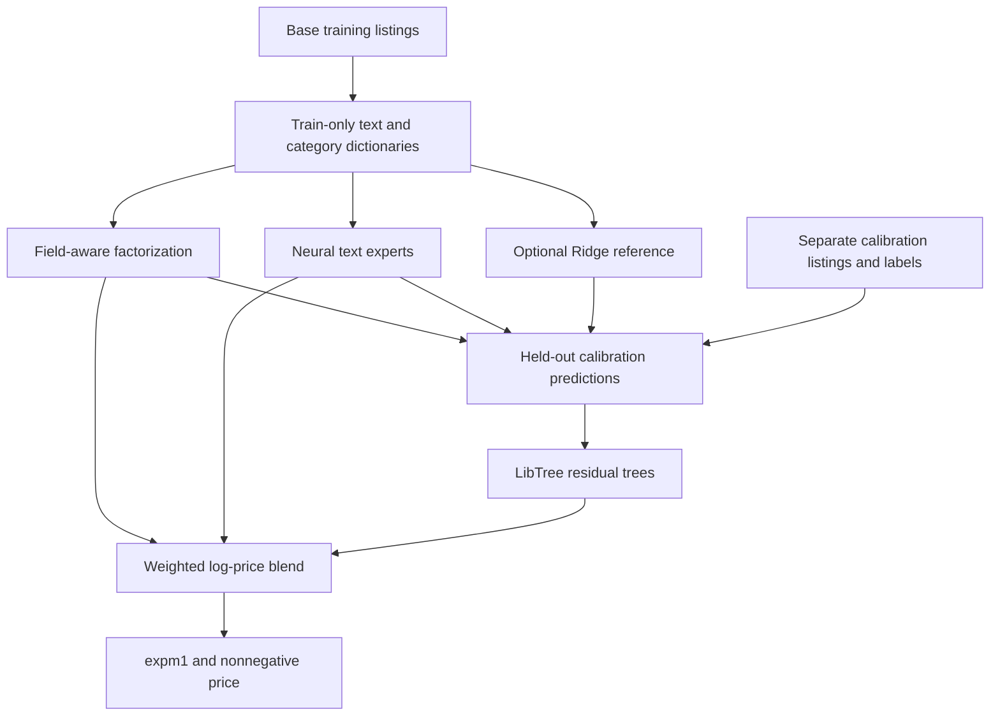

# Mercari: reducing RMSLE by 10% while measuring the cost

[中文](TECHNICAL_REPORT.zh-CN.md) · [Beginner guide](BEGINNER_GUIDE.md) · [Experiment details and commands](OPTIMIZATION.md)

Results were collected on **October 17, 2026 (UTC)**. This report explains the
released experiment at commit `e711973`; it adds no new training results.
Mercari ended in 2018, so these are scored practice submissions, with no new
official contest rank.

## Executive summary

- Both frozen candidates meet the target of reducing private RMSLE by 10%
  relative to 0.43776. Accuracy reaches **0.39199**; fast reaches **0.39361**.
- The gain comes from engineered features and complementary text models with
  LibTree residual calibration. It is not evidence that native GBDT alone
  improved by 10%, or that it beats XGBoost/LightGBM on this task.
- Fast trades a small amount of accuracy for cost. Its observed local process
  is 17.0% shorter than accuracy; its mean inference time is 12.45% lower in a
  separate four-repeat comparison. Both ensembles remain slower than the old
  baseline. Full refits were measured once per variant.

| Frozen system | Public RMSLE ↓ | Private RMSLE ↓ | Relative private reduction | Actual submission |
| --- | ---: | ---: | ---: | --- |
| Ridge + LibTree baseline | 0.43775 | 0.43776 | — | [57307868](kaggle-submission-57307868.json) |
| Accuracy ensemble | 0.39110 | 0.39199 | 10.46% | [57318931](kaggle-submission-57318931.json) |
| Fast ensemble | 0.39278 | 0.39361 | 10.09% | [57319422](kaggle-submission-57319422.json) |

Every listed submission is `COMPLETE`. Reduction means
`1 - candidate_private_RMSLE / 0.43776`; the acceptance threshold is **0.393984**.
[Result summary](optimization-results.json) and [journal](record.json) retain
the exact versions, scores, hashes and failed execution attempts.

## 1. Task, metric and validation

Predict a listing's price from its title, description, category, brand, item
condition and shipping flag. Official training contains **1,482,535 rows**,
including 874 zero prices. The final test file contains **3,460,725 rows**.
Missing text and categories have explicit handling; zero prices are retained.
No test labels, scraped prices or external pretrained inputs are used.

```text
z = log1p(price)
RMSLE = sqrt(mean((log1p(predicted_price) - z)^2))
predicted_price = expm1(max(predicted_log_price, 0))
```

Learning log price aligns squared error with the metric and reduces the influence
of absolute dollar scale. It does not make every transformed loss equivalent:
Huber and price-bin classification are alternative training objectives, evaluated
using the same RMSLE [R1, R7].

Identical values of the six available feature columns form one listing group;
price and ID do not enter the group key. Grouped seed-42 splitting gives:

| Window | Rows | Role |
| --- | ---: | --- |
| Base fitting | 1,186,026 | Fit text dictionaries, encoders and experts |
| Calibration, within tuning | 74,129 | Fit LibTree residual correction |
| Selection, within tuning | 74,126 | Select settings and blend weights |
| Original holdout | 148,254 | Audit the frozen accuracy configuration |

Vocabulary, brand recovery and target statistics use only the base window.
Calibration labels train the correction, so calibration error is not independent
validation. The selection window is reused during exploration; it is not an
unbiased final test. Accuracy was frozen before its holdout audit; fast was
selected on existing selection data and has **no separate local holdout score**.
Both final configurations were frozen before their new Kaggle scores arrived.
These safeguards follow grouped validation and stacking principles [R2, R3].

Final refits use a different grouped split: **1,395,326 base rows** and **87,209
calibration rows**. All labels contribute in different roles. No new model
selection occurs in the final refit. This random grouped evaluation cannot
establish temporal or seller-level generalization: those identifiers are absent.

## 2. Architecture and the theory behind it



**Represent the listing faithfully.** Preserve single-character model tokens
such as `6` and `x`; normalize `iphone6s` to `iphone 6s` while retaining `64gb`.
Add category levels, character n-grams, brand/category/condition interactions and
smoothed training-only price summaries. Recover missing brands only from
unambiguous matches in the fitted training dictionary. Target encoding must not
read the evaluated window's labels [R4].

**Solve the sparse baseline adequately.** Ridge minimizes
`||Xw + b - z||² + alpha ||w||²`. Matrix-free preconditioned conjugate gradients
avoid constructing `XᵀX`; implicit centering handles the intercept. Independent
tests compare against a dense Cholesky solution. More features did not help when
the old LSQR solver stopped before a good solution [R5, R6].

**Model interactions.** A field-aware factorization model uses low-rank vectors
for interactions such as title word × brand. Unlike an ordinary factorization
machine, a feature has different vectors for the other feature's field [R8].
Numba workers own separate parameters and synchronize between chunks, avoiding
concurrent writes to shared parameters. More workers are not assumed to preserve
the same optimization trajectory or to accelerate every problem [R9].

**Combine different errors.** Accuracy uses sparse MLPs trained with Huber and
64-bin price classification, plus a word-pooling MSE model. The classification
head's expected log price is `sum(bin_probability * bin_center)`. Fast drops the
global-Adam sparse expert, retaining three neural members. Neural diversity is
inspired by published Mercari solutions, implemented independently here [R10].

**Respect sparse updates.** A CSR input does not guarantee sparse training:
global L2 and some optimizer updates can touch the whole embedding matrix.
The row-sparse Adam variant combines duplicate gradient indices and updates
present rows; dense layers retain standard Adam. It also removes global matrix
L2. Its results therefore do not isolate an optimizer-only effect, and the
variant is not mathematically identical to dense Adam [R11].

**Correct residuals on separate listings.** With expert log predictions `p(x)`,
weights `w` and correction strength `s`, the system is:

```text
base(x) = p(x) · w
residual_target = log1p(price) - base(x)       # calibration rows only
final_log_price(x) = base(x) + s * LibTree(metadata(x), p(x))
```

The corrector has 300 depth-three trees, learning rate .04, L2 20, 128 bins,
leaf minimum 100 and two native threads. The accuracy outer weights are
`[0, .26, .74]`; fast uses `[0, .30, .70]`. A zero Ridge **blend** weight does
not imply no work: accuracy still supplies its Ridge prediction as a correction
feature. Fast disables that reference and names its replacement `mean_prior`.
See [frozen accuracy](optimized-config.json), [fast](fast-config.json) and
[GBDT design](../../docs/design.md) [R3, R12].

## 3. What succeeded, and how strong the evidence is

First compare **the same 148,255-row tuning window before calibration**:

| Comparison | RMSLE before → after | Interpretation |
| --- | ---: | --- |
| LSQR → preconditioned Ridge, expanded features, alpha 3 | .449036 → .440556 | Solve the same objective better before increasing capacity |
| Ridge alpha 10, original → repaired tokens | .437211 → .435320 | Preserving model/size tokens helped this representation |
| Field-aware model, original → repaired tokens | .423157 → .420152 | Text handling also helped the interaction model |
| Word-pooling MSE → Huber | .432245 → .432122 | Small standalone change, not a major isolated win |

These are exploratory comparisons, not independent confirmatory tests.
[Exploration evidence](optimization-study.json) preserves the runs. Timings
from overlapping exploratory fits are not used to claim speedups.

The frozen **148,254-row holdout** gives a separate component comparison:

| System | Holdout RMSLE ↓ |
| --- | ---: |
| Original Ridge + LibTree | .439312 |
| New Ridge alone | .433543 |
| Field-aware model alone | .418600 |
| Neural mixture alone | .397625 |
| New blend without native correction | .395064 |
| New blend with native correction | **.394153** |

The complete system improves holdout RMSLE by **10.28%**. Removing only the native
correction worsens RMSLE by **.000910** with the same fitted experts. Individual
expert rows are standalone diagnostics, not additive contributions to the total
gain. [Holdout evidence](optimization-audit.json) binds the split and source hashes.

## 4. Failures and decisions worth preserving

| Attempt | Observed result | Decision and lesson |
| --- | --- | --- |
| Add many features with capped LSQR | Alpha-3 tuning RMSLE .449036 at 200 iterations | Improve numerical solution before declaring features ineffective |
| Continue field-aware training | Repaired-token tuning RMSLE .420152 at epoch 2, .426392 at epoch 3; training error continued falling | Freeze two epochs; lower training error can mean worse generalization |
| CNN and continuous sparse alternatives | CNN screening stopped; continuous sparse tuning RMSLE .420258 had marginal blend value | Complexity needs incremental validation benefit per cost; no independent holdout claim |
| Remove Ridge reference alone | Selection .395662 → .395712 | Small quality cost justified an optional cheaper path, not silent removal from accuracy |
| Drop global-Adam expert and Ridge reference | Rounded fast selection .397274 | Keep a separate configuration; actual private score .39361 still passes target |
| Increase sparse batch to 16,384 | Accuracy study 35.761 → 33.184 s mean; fast study 33.873 → 38.376 s | Batch tuning depends on model and workload; submitted default remains 8,192 |
| Share first-layer projection | Joint means 34.754/37.430 s vs eager 33.754 s | Discard; small numerical differences are not a speed win |
| Accuracy 3,600-second executions | Stage-two v3 and independent stage-one check returned cancellation near cap; API reason empty | Preserve failures; v4's extended stage-two cap does not verify stage-one eligibility |
| Assume flat Kaggle input paths | Baseline v1 failed before training | Search nested mounts and protect with a regression test |
| Use `PYTHONPATH=python:.` in the wheel job | Unbuilt source package shadowed installed native extension | Test installed wheel with `PYTHONPATH=.` |
| Read artifact index immediately after completion | Fast stage-one output index was initially empty, later populated | Retry read-only metadata with bounds; verify source/markers before submitting |

Evidence: [cost ablations](cost-ablation.json), [batch study](sparse-batch-study.json),
[joint projection](joint-projection-study.json), [budget verification](fast-stage-one-budget.json),
[run journal](record.json), [CI workflow](../../.github/workflows/test.yml).

## 5. Performance and resource trade-offs

Local environment: Linux, Python 3.12, **four-CPU quota**, 32-GiB memory limit,
no GPU. Local dependencies are pinned in [`pyproject.toml`](../../pyproject.toml).
CPU affinity alone is not the usable CPU budget; see [environment](environment.json).

| Local full refit, each observed once | Accuracy | Fast |
| --- | ---: | ---: |
| Process wall time, including full prediction | 53.75 min | 44.63 min |
| Sum of measured fitting/preparation stages | 2,009.267 s | 1,454.908 s |
| Full 3,460,725-row prediction, features and CSV I/O | 1,184.582 s | 1,186.193 s |
| Peak RSS | 10.15 GiB | 10.04 GiB |

Fast saves 17.0% process time and 27.6% in the measured fitting/preparation
stages, but full prediction is effectively equal in these single observations.
Fast saves a model pickle; the accuracy run omitted it. Accuracy also included
short tooling checks. These are not repeated, identically scoped training trials.
[Accuracy resources](optimization-resources.json) · [Fast resources](fast-resources.json).

Separate serving experiment: first 100,000 unlabeled test rows, one warm-up and
four balanced rotating repetitions, four CPU threads / two FM threads:

| Complete pipeline | Mean, s | Min, s | Max, s | Population std, s |
| --- | ---: | ---: | ---: | ---: |
| Old scored baseline | 8.383 | 7.678 | 9.658 | .796 |
| Accuracy | 38.688 | 32.970 | 45.602 | 5.391 |
| Fast, batch 8,192 | 33.873 | 29.509 | 43.880 | 5.812 |
| Fast, batch 16,384 | 38.376 | 32.386 | 44.097 | 5.379 |

Arithmetic means give a **12.45% reduction for fast vs accuracy**; raw samples
retain slow observations. Timings include features and prediction, exclude
loading, input I/O and validation. Accuracy/fast share 80%-window dictionaries
and retained expert weights; the old baseline was fitted on all labels. This
is a complexity comparison, not the full-refit deployment comparison above.
Variance is substantial; four repetitions do not establish universal speedups.
[Raw serving evidence](accuracy-fast-serving.json).

Kaggle runner times were **100.04 min accuracy / 65.59 min fast**, one run each,
with 120-minute stage-two caps. Different library versions and hardware prevent
using local/cloud differences as a controlled optimization comparison. Fast's
independent stage-one check passed in **44.04 min**. Accuracy's was cancelled
near 60 minutes, so its stage-one condition remains unverified. The original
rules' RAM/scratch requirements are not fully re-established by these timing
checks. [Protocol](competition.json) · [Stage-two time exception](https://www.kaggle.com/c/mercari-price-suggestion-challenge/discussion/45554).

## 6. Engineering validation and reproduction boundaries

The test-first workflow uses independent mathematical references, then behavioral
integration checks: dense vs sparse Ridge, explicit factorization interactions,
duplicate sparse gradients, train-only dictionaries, group separation, refits,
serialization, prediction replay, contribution sums, nested mounts and CLI errors.
See [test files](../../tests/test_mercari_advanced.py) and [verification](optimization-verification.json).

The released code passed **54 Mercari tests, 1,096/1,096 Python statements**,
plus four separately compiled FM tests. Numba statement coverage executes
reference kernels with `NUMBA_DISABLE_JIT=1`; it is not compiled-code or branch
coverage. Core coverage is 505/505 Python statements and 2,790/2,790 C++ lines.
[Release CI](https://github.com/wxwidget/libtree/actions/runs/39052567241)
also passed native sanitizer, thread sanitizer, format and benchmark checks.
Coverage is evidence about executed code, not proof of model quality or no bugs.

The [beginner guide](BEGINNER_GUIDE.md) gives copyable commands for installation,
a credential-free synthetic smoke run, official data, study/audit/final modes,
serving measurements and exact-version Kernel submissions. A new run should
retain config, source/data hashes, split IDs, versions, raw timings and API status.
Exact Kaggle score replay is not guaranteed across platforms. Exploratory
scratch scripts/caches and the historical uploaded scripts are not all shipped;
selected pipelines can be retrained, while archived hashes identify the original
runs rather than magically reconstructing their bytes. The historical source
commits and Kernel versions are recorded in each submission evidence file.

## 7. Reading and implementation map

| Reference | What it supports | Start in this repository |
| --- | --- | --- |
| R1. [Official Mercari task](https://www.kaggle.com/competitions/mercari-price-suggestion-challenge) | Data, RMSLE and submission protocol | [Journal](README.md) |
| R2. [scikit-learn: grouped cross-validation](https://scikit-learn.org/stable/modules/cross_validation.html#cross-validation-iterators-for-grouped-data) | Keep duplicate groups together | [Splits](../mercari.py) |
| R3. [Wolpert, stacked generalization, 1992](https://doi.org/10.1016/S0893-6080(05)80023-1) | Learn combinations on predictions outside base fitting | [Calibration](../mercari_advanced.py) |
| R4. [Micci-Barreca, categorical encoding, 2001](https://doi.org/10.1145/507533.507538) | Smoothed label statistics | [Listing/residual features](../mercari_features.py) |
| R5. [scikit-learn: Ridge](https://scikit-learn.org/stable/modules/linear_model.html#ridge-regression-and-classification) | L2-regularized linear prediction | [Sparse solver](../mercari_solver.py) |
| R6. [Hestenes & Stiefel, conjugate gradients, 1952](https://doi.org/10.6028/jres.049.044) | Iterative solution of linear systems | [Solver tests](../../tests/test_mercari_solver.py) |
| R7. [Huber, robust estimation, 1964](https://doi.org/10.1214/aoms/1177703732) | Quadratic/linear robust loss | [Sparse experts](../mercari_sparse.py) |
| R8. [Rendle, FM, 2010](https://doi.org/10.1109/ICDM.2010.127); [Juan et al., FFM, 2016](https://doi.org/10.1145/2959100.2959134) | Low-rank and field-aware interactions | [FM implementation](../mercari_fm.py) |
| R9. [Stich, local SGD, 2019](https://openreview.net/forum?id=S1g2JnRcFX) | Background for independent workers and synchronization; not a convergence proof for this implementation | [FM worker tests](../../tests/test_mercari_fm.py) |
| R10. [Jankiewicz & Lopuhin, Mercari presentation](https://github.com/pjankiewicz/mercari-solution/blob/374301ad1c32cbc93dcc40313d5d7bb9c5503746/presentation/5_modeling.tex); [Chen, Mercari report](https://github.com/ChenglongChen/tensorflow-XNN/tree/6534a832f5b4461cbdf1ebbdf5620a0cd80f0aa9) | Sparse networks, losses and complementary models | [Neural models](../mercari_neural.py) |
| R11. [Kingma & Ba, Adam, 2015](https://arxiv.org/abs/1412.6980) | Adaptive optimizer background; row-sparse variant differs | [Sparse update tests](../../tests/test_mercari_sparse.py) |
| R12. [Friedman, gradient boosting, 2001](https://doi.org/10.1214/aos/1013203451) | Additive trees fitted to loss gradients | [Native design and citations](../../docs/design.md) |

Read R1/R2/R5 and the beginner guide first. Then study the calibration equation,
R8/R11 and numerical tests. Historical winning solutions provide ideas; their
published scores are not measurements of LibTree.
