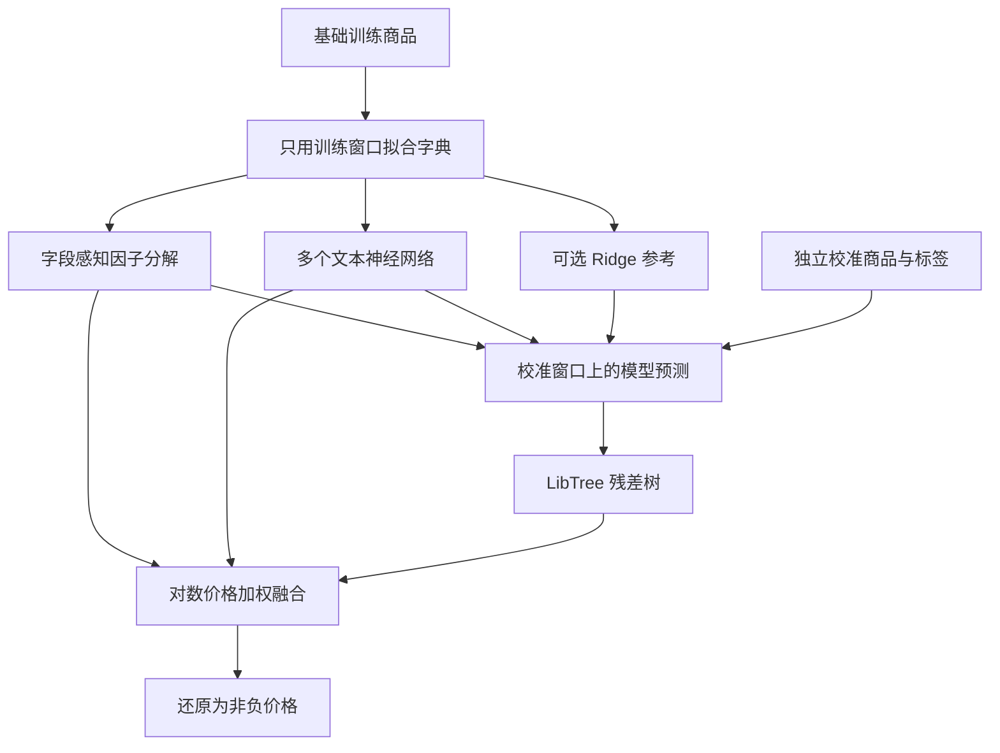

# Mercari 技术报告：误差降低 10%，同时核算计算成本

[English](TECHNICAL_REPORT.md) · [初学者指南](BEGINNER_GUIDE.zh-CN.md) · [完整实验记录](OPTIMIZATION.zh-CN.md)

测量截止 **2026 年 10 月 17 日 UTC**，对应已发布的 `e711973` 快照。
本文整理已有实验，没有新增训练或评分。原比赛已于 2018 年结束，当前成绩属于赛后练习。

## 主要结论

- 精度版 private RMSLE 为 **0.39199**，相对原基线下降 **10.46%**；轻量版为
  **0.39361**，下降 **10.09%**。两版均已实际完成 Kaggle 评分。
- 收益来自特征工程、多种文本模型和 LibTree 残差校准组成的完整系统，不能解释为
  原生 GBDT 算法独自提升 10%，本实验也没有证明优于 XGBoost／LightGBM。
- 轻量版相对精度版，本地单次完整进程耗时减少 **17.0%**，另一次四次重复推理对照的
  平均耗时减少 **12.45%**。两种新版融合仍比旧基线推理慢。

| 冻结配置 | Public RMSLE ↓ | Private RMSLE ↓ | Private 相对降幅 | 真实提交 |
| --- | ---: | ---: | ---: | --- |
| 原 Ridge + LibTree | 0.43775 | 0.43776 | — | [57307868](kaggle-submission-57307868.json) |
| 精度融合版 | 0.39110 | 0.39199 | 10.46% | [57318931](kaggle-submission-57318931.json) |
| 轻量融合版 | 0.39278 | 0.39361 | 10.09% | [57319422](kaggle-submission-57319422.json) |

状态均为 `COMPLETE`。降幅公式为 `1 - 新 private RMSLE / 0.43776`，验收阈值为
**0.393984**。[汇总](optimization-results.json)及[流水](record.json)保留版本、哈希、
评分和失败运行，不将当前分数转换成原赛事名次。

## 1. 任务、指标与数据划分

任务是根据标题、描述、品类、品牌、成色和运费承担方预测商品价格。官方训练集
**1,482,535 行**，含 874 条零价格；最终测试集 **3,460,725 行**。缺失字段有明确处理，
零价格保留，没有引入测试标签、抓取价格或外部预训练输入。

```text
z = log1p(price)
RMSLE = sqrt(mean((log1p(predicted_price) - z)^2))
predicted_price = expm1(max(predicted_log_price, 0))
```

在对数价格上训练，可以与官方指标对齐，避免大额商品仅凭绝对金额主导平方误差。
Huber 和分档分类是另外的训练目标，最终仍统一计算 RMSLE，不能直接比较它们的 loss 数字。

六个可用特征字段完全相同的商品作为同一组，价格与 ID 不参与分组。seed 42 的原划分为：

| 窗口 | 行数 | 用途 |
| --- | ---: | --- |
| 基础训练 | 1,186,026 | 拟合词表、特征字典与基础模型 |
| 调参窗口内的校准集 | 74,129 | 拟合 LibTree 残差 |
| 调参窗口内的选择集 | 74,126 | 比较参数与融合权重 |
| 原独立留出集 | 148,254 | 审计已经冻结的精度版 |

品牌恢复字典、词表、目标均值等只使用基础训练窗口。校准标签参与训练，因此校准误差
不是独立验证；选择集被探索反复使用，也不是无偏最终测试。精度版冻结后才审计原留出集。
轻量版只使用已有选择集，**没有单独的本地留出成绩**。两版均在新 Kaggle 评分返回前冻结。

最终重训另按组划分 **1,395,326 条基础模型样本**和 **87,209 条校准样本**，所有标签
以不同角色参与最终系统，不在重训时重新选参数。数据缺少卖家 ID 和时间，不能将分组随机
划分描述成卖家外推或时间外推测试。

## 2. 系统架构与所需理论



**表示层：先别丢掉有价值的信息。** 保留 `6`、`x` 等型号字符，把 `iphone6s` 规范为
`iphone 6s`，保留 `64gb`。加入字符 n-gram、品类层级、品牌／品类／成色交叉，以及训练
窗口的平滑价格统计。缺失品牌只从训练字典做无歧义恢复。目标编码不能读取被评估窗口的标签。

**线性层：先确保目标函数解得足够好。** Ridge 的目标是
`||Xw + b - z||² + alpha ||w||²`。预条件共轭梯度通过矩阵向量乘法求解，不构造巨大的
`XᵀX`；隐式中心化处理截距。独立测试与稠密 Cholesky 解对照。这里不是换了更复杂的模型，
而是先把同一个线性目标求解得更充分。

**交互层：学习组合。** 字段感知因子分解用小向量表示“标题词 × 品牌”等交互；与普通 FM
不同，一个特征会为对方所在的字段准备不同向量。Numba worker 各自持有参数，按块同步，
避免共享参数并发写入。增加 worker 也会影响优化轨迹，不能假设线程越多越快或输出不变。

**神经网络层：利用不同错误模式。** 精度版融合稀疏 MLP 的 Huber 回归、64 档价格分类及
词袋池化 MSE 模型；分档头用 `sum(档位概率 × 对数价格中心)` 转回对数价格。
轻量版去掉全矩阵 Adam 的稀疏网络，保留三个神经网络成员。

**优化器层：稀疏输入不等于稀疏训练。** 全矩阵 L2 和部分优化器更新可能访问整个矩阵。
按行更新的 Adam 先合并重复梯度索引，只更新出现的行，稠密层仍用普通 Adam。
该变体同时去掉全矩阵 L2，因此不能把全部差异归因于优化器；它也不与稠密 Adam 数学等价。

**校准层：在基础模型未拟合过的商品上学残差。**

```text
base(x) = 专家对数预测 p(x) · 权重 w
残差训练目标 = log1p(price) - base(x)    # 仅校准窗口
最终对数价格 = base(x) + s * LibTree(商品统计特征, p(x))
```

校准器使用 300 棵深度 3 的树、学习率 .04、L2 20、128 桶、叶子至少 100 条及两个原生线程。
精度版外层权重 `[0, .26, .74]`；轻量版 `[0, .30, .70]`。精度版 Ridge 的直接权重虽然
为零，仍作为校准器输入，不能据此判定可以免费删除。轻量版显式关闭 Ridge 参考，替代项
在解释中标为 `mean_prior`。[精度参数](optimized-config.json) · [轻量参数](fast-config.json)。

## 3. 成功经验与证据边界

下面各行均比较相同 **148,255 条调参样本**，位于校准前：

| 对照 | RMSLE 前 → 后 | 可支持的解释 |
| --- | ---: | --- |
| 扩展特征、alpha 3，LSQR → 预条件 Ridge | .449036 → .440556 | 扩容量前应先解决求解不足 |
| alpha 10 Ridge，原分词 → 修复分词 | .437211 → .435320 | 型号／尺寸表示确有帮助 |
| 字段感知模型，原分词 → 修复分词 | .423157 → .420152 | 同一特征修复也帮助交互模型 |
| 词袋池化 MSE → Huber | .432245 → .432122 | 单模型改进很小，不能夸大 |

这些是探索性对照，不是独立确认实验；[原始探索记录](optimization-study.json)保留所有候选。
并发探索时的耗时不能当成受控速度提升。

冻结后的 **148,254 条独立留出样本**提供另一组组件对照：

| 模型 | 留出 RMSLE ↓ |
| --- | ---: |
| 原 Ridge + LibTree | .439312 |
| 新 Ridge | .433543 |
| 字段感知模型 | .418600 |
| 神经网络融合 | .397625 |
| 新融合去掉原生校准 | .395064 |
| 新融合加上原生校准 | **.394153** |

完整系统相对原基线下降 **10.28%**；固定基础模型，仅去掉原生校准，RMSLE 恶化约
**.000910**。各专家单独成绩是诊断值，不能相加得到总收益。[留出审计](optimization-audit.json)
记录样本 ID 与源码哈希。

## 4. 失败、代价与取舍

| 尝试 | 真实观察 | 保留的经验 |
| --- | --- | --- |
| 扩展特征但 LSQR 限 200 步 | alpha 3 调参 RMSLE .449036 | 先排除数值求解不足 |
| 字段感知模型继续训练 | 第 2 轮 .420152，第 3 轮 .426392，训练误差却继续下降 | 固定两轮；训练更久可能过拟合 |
| CNN／连续稀疏输入 | CNN 筛选后停止；连续稀疏候选 .420258，融合增益有限 | 复杂度需要验证收益和成本支撑，没有独立留出结论 |
| 单独关闭 Ridge 参考 | 选择集 .395662 → .395712 | 用独立轻量配置表达取舍，不悄悄改变精度版 |
| 再删除全矩阵 Adam 网络 | 轻量版选择集 .397274 | 最终 private .39361 仍达标 |
| 稀疏批扩大到 16,384 | 精度版均值 35.761 → 33.184 秒；轻量版 33.873 → 38.376 秒 | 批大小依赖模型与负载，提交仍用 8,192 |
| 共享首层投影 | 34.754／37.430 秒，对照 33.754 秒 | 没有速度收益，弃用 |
| 精度版设置 3,600 秒 | 第二阶段 v3 与独立第一阶段均在限制附近取消，API 原因为空 | 延长第二阶段不能证明第一阶段合规 |
| 假设 Kaggle 输入平铺 | 原基线 v1 在训练前失败 | 递归查找挂载，加入回归测试 |
| wheel CI 设置 `PYTHONPATH=python:.` | 未编译的源码包遮蔽已安装原生扩展 | 用 `PYTHONPATH=.` 验证真正安装的 wheel |
| 完成立刻读取产物索引 | 轻量版第一阶段短暂返回空索引，稍后补齐 | 有界重试只读元数据，提交前仍核验源码和标记 |

来源：[成本消融](cost-ablation.json)、[批大小](sparse-batch-study.json)、
[共享投影](joint-projection-study.json)、[预算检查](fast-stage-one-budget.json)、
[流水](record.json)及[CI](../../.github/workflows/test.yml)。

## 5. 性能、内存与预算

本地为 Linux、Python 3.12、**四 CPU 配额**、32 GiB 内存上限，无 GPU。
依赖版本锁定于 [pyproject.toml](../../pyproject.toml)。CPU affinity 数量不等于真实配额，
参见[环境记录](environment.json)。

| 本地完整重训，每项一次 | 精度版 | 轻量版 |
| --- | ---: | ---: |
| 完整进程，含最终预测 | 53.75 分钟 | 44.63 分钟 |
| 已计量拟合／准备阶段合计 | 2,009.267 秒 | 1,454.908 秒 |
| 全部 3,460,725 条预测、特征及 CSV 写入 | 1,184.582 秒 | 1,186.193 秒 |
| 峰值 RSS | 10.15 GiB | 10.04 GiB |

完整进程减少 17.0%，已计量拟合／准备阶段减少 27.6%，但两版全量预测基本相同。
轻量版保存模型 pickle，精度版省略；精度版还有短暂工具检查。这不是范围完全相同的
重复训练试验。[精度资源](optimization-resources.json) · [轻量资源](fast-resources.json)。

另一次推理对照使用相同前 10 万条无标签测试样本、预热一次、顺序平衡的四次重复，
四线程／两个 FM 线程：

| 完整管线 | 平均秒数 | 最小 | 最大 | 总体标准差 |
| --- | ---: | ---: | ---: | ---: |
| 原基线 | 8.383 | 7.678 | 9.658 | .796 |
| 精度版 | 38.688 | 32.970 | 45.602 | 5.391 |
| 轻量版，批 8,192 | 33.873 | 29.509 | 43.880 | 5.812 |
| 轻量版，批 16,384 | 38.376 | 32.386 | 44.097 | 5.379 |

算术平均值显示轻量版默认批大小相对精度版减少 **12.45%**，原始数据保留慢样本。
包含特征与预测，排除模型加载、输入 I/O 和结果校验。两版复用相同 80% 基础窗口的字典
及保留专家权重；旧基线则用全部标签拟合。该对照不同于上表的最终重训模型，不能混用。
四次重复且波动较大，不能外推成普遍加速。[原始计时](accuracy-fast-serving.json)。

Kaggle 程序分别运行 **100.04／65.59 分钟**，各一次，第二阶段上限均为 120 分钟。
轻量版独立第一阶段 **44.04 分钟**通过；精度版在 60 分钟附近取消，条件仍未验证。
这些检查也没有完整复核原比赛的内存与临时空间要求。本地／云端版本及硬件不同，不能据此
推导受控加速。[原规则](competition.json) · [第二阶段时限例外](https://www.kaggle.com/c/mercari-price-suggestion-challenge/discussion/45554)。

## 6. TDD、覆盖率与复现边界

测试先定义可失败的行为及独立数学参考，再实现和重构：稠密解对照、显式交互公式、
重复稀疏梯度、训练字典边界、分组隔离、序列化、解释求和、挂载路径和 CLI 错误。
参见[集成测试](../../tests/test_mercari_advanced.py)和[验证记录](optimization-verification.json)。

已发布代码通过 **54 项 Mercari 测试、1,096/1,096 条 Python 语句覆盖**，另测四项
真实编译 FM 内核。Numba 覆盖用 `NUMBA_DISABLE_JIT=1` 跑参考内核，不等于编译代码或
分支全覆盖。核心为 Python 505/505 条语句、C++ 2,790/2,790 行。
[发布 CI](https://github.com/wxwidget/libtree/actions/runs/39052567241)同时通过 sanitizer、
线程 sanitizer、格式和 benchmark。覆盖率不证明模型效果，也不证明没有缺陷。

[初学者指南](BEGINNER_GUIDE.zh-CN.md)给出安装、无凭据小练习、官方数据下载、
study／audit／final、推理对照与指定 Kernel 版本提交的命令。新运行应保留参数、源码／数据
哈希、划分、版本、全部计时和 API 状态。不同平台不保证逐位相同或再次得到完全相同分数。
探索脚本、缓存和历史上传脚本没有全部随仓库发布；可以重训选定管线，历史哈希用于辨认
原运行，不代表仅凭哈希就能重建其字节。每个提交证据保存对应源码提交和 Kernel 版本。

## 7. 理论与推荐阅读顺序

| 先后 | 理论与链接 | 阅读目的／对应代码 |
| --- | --- | --- |
| 1 | [官方任务](https://www.kaggle.com/competitions/mercari-price-suggestion-challenge)、[分组验证](https://scikit-learn.org/stable/modules/cross_validation.html#cross-validation-iterators-for-grouped-data) | 先理解指标与泄漏；[划分代码](../mercari.py) |
| 2 | [Ridge 入门](https://scikit-learn.org/stable/modules/linear_model.html#ridge-regression-and-classification)、[共轭梯度原论文](https://doi.org/10.6028/jres.049.044) | 线性基线和求解；[求解器](../mercari_solver.py) |
| 3 | [Wolpert，Stacking，1992](https://doi.org/10.1016/S0893-6080(05)80023-1)、[Micci-Barreca，目标编码，2001](https://doi.org/10.1145/507533.507538) | 在未参与基础拟合的样本上组合；[校准](../mercari_advanced.py)、[特征](../mercari_features.py) |
| 4 | [Rendle，FM，2010](https://doi.org/10.1109/ICDM.2010.127)、[Juan 等，FFM，2016](https://doi.org/10.1145/2959100.2959134) | 低秩交互与字段感知；[FM](../mercari_fm.py) |
| 5 | [Huber，1964](https://doi.org/10.1214/aoms/1177703732)、[Adam，2015](https://arxiv.org/abs/1412.6980) | 损失与优化器；[稀疏实现](../mercari_sparse.py) |
| 6 | [Stich，Local SGD，2019](https://openreview.net/forum?id=S1g2JnRcFX) | 独立 worker 与同步的背景，不作为当前实现的收敛证明 |
| 7 | [Friedman，GBDT，2001](https://doi.org/10.1214/aos/1013203451)、[本库设计说明](../../docs/design.zh-CN.md) | 残差树与梯度提升 |
| 8 | [Jankiewicz／Lopuhin 的 Mercari 报告](https://github.com/pjankiewicz/mercari-solution/blob/374301ad1c32cbc93dcc40313d5d7bb9c5503746/presentation/5_modeling.tex)、[Chen 的报告](https://github.com/ChenglongChen/tensorflow-XNN/tree/6534a832f5b4461cbdf1ebbdf5620a0cd80f0aa9) | 学习稀疏网络、损失与融合思路；这里为独立实现，不借用前人成绩 |

先读初学者指南、指标、Ridge 和分组验证，再看校准公式、FFM、优化器及其独立测试。
